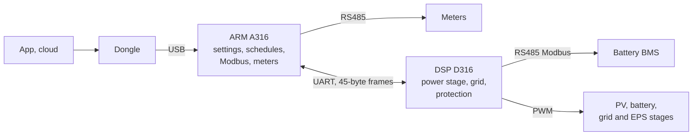

# forgiv

[](https://github.com/abedegno/forgiv/actions/workflows/gate.yml)

Byte-exact decompilations of GivEnergy firmware: C and assembly source that the original
compiler and linker turn back into the shipped firmware image, byte for byte. I made them to
understand how the equipment works, in particular how the inverter treats its battery.

The repository holds the Hybrid Gen3 LV inverter's two firmwares. I plan to add more (batteries,
other inverters, other versions), one firmware per directory.

## Status

| Firmware | Chip | Toolchain | Byte-exact | From proved source | Original bytes (blobs) | Readable |
|---|---|---|---|---|---|---|
| [Gen3 LV inverter, ARM A316](inverters/gen3-lv/a316/README.md) | STM32F105/107 (Cortex-M3) | Keil armcc 5.06 (MDK 5.21), MDK 5.16 library | yes: `ARMStore.bin` and its HEX form | 143,854 of 145,320 bytes (99.0%); the rest is Keil's C library, the region table and padding made by armlink | 0 | yes: names, headers, comments |
| [Gen3 LV inverter, DSP D316](inverters/gen3-lv/d316/README.md) | TMS320F2806x (C28x with FPU) | TI CGT 16.9.6, 15.12.3 runtime library | yes: `DSPStore.bin`, word for word | 48,555 of 65,536 words (74.1%); 1.9% TI's runtime library, 24.0% erased-flash fill | 0 | yes: names, headers, comments |

"Byte-exact" means each tree's gate (`tools/gate.py`) compiles every source, links the whole
image with the original vendor's tools and compares it with the vendor's file, and says
IDENTICAL. "Original bytes 0" means nothing of the image is copied in: every byte comes from a
source file in the tree, from the toolchain's own libraries, or from the linker.

## Quick start

You need the firmware images (fetched below), the toolchains
([docs/development/toolchains.md](docs/development/toolchains.md)) and, for A316, a checkout of
[Exhume](https://github.com/abedegno/Exhume), the toolkit the matching was done with. Python 3.11
or later. [docs/development/building.md](docs/development/building.md) has the details.

```sh
python3 tools/fetch_firmware.py          # downloads the package, checks the sha256s, fills firmware/

# A316 (ARM)
cd inverters/gen3-lv/a316
export EXHUME=/path/to/Exhume MDK_TOOLCHAIN=/path/to/mdk-homes
$EXHUME/.venv/bin/python tools/gate.py   # about 1 minute; ends with "-- gate: PASS"

# D316 (DSP)
cd ../d316
export C2000_WINEPREFIX=/path/to/wine-prefix C2000_CGT=/path/to/ti-cgt-c2000_16.9.6.LTS \
       C2000_RTSLIB=/path/to/c2000_15.12.3.LTS/lib/rts2800_fpu32.lib \
       C2000_NATIVE=/path/to/ti-cgt-c2000_18.12.8.LTS/bin
python3 tools/gate.py                    # about 2 minutes; ends with "IDENTICAL" and "PASS"
```

Instead of environment variables, each tree takes a `toolchain.local.toml` (gitignored; copy
its `toolchain.example.toml`). Each tree's README lists its settings and their defaults.

`python3 tools/repocheck.py` runs the checks that need neither toolchain nor images (CI runs it).

## Layout

    README.md, LICENSE, NOTICE.md     this page, the licence of my own work, what is not mine
    CONTRIBUTING.md                   how to add a firmware
    firmware/manifest.toml            where each image comes from, with its sha256
    tools/fetch_firmware.py           fetches and checks the images, puts them in firmware/
    tools/repocheck.py                repository checks for CI
    docs/                             the documentation across both chips (below)
    docs/development/toolchains.md    installing the toolchains
    docs/development/method.md        how byte-exact matching works here
    inverters/gen3-lv/                the Hybrid Gen3 LV inverter (its README: the two chips)
      a316/                           the ARM firmware A316: src, map, tools, docs
      d316/                           the DSP firmware D316: src, map, tools, docs
    batteries/                        none yet

Each firmware directory is self-contained: its own sources (`src/`), map of the image (`map/`),
tools (`tools/`, with the gate), notes (`docs/`) and toolchain configuration.

## Documentation

Start at [docs/README.md](docs/README.md), which has reading paths for owners, developers and
researchers. The pages there describe the inverter across both chips, each rule with the function
and file it comes from:

- **system**: [architecture](docs/system/architecture.md), [hardware](docs/system/hardware.md),
  [update packages](docs/system/update-packages.md);
- **operation**: [start-up](docs/operation/startup.md), [states](docs/operation/states.md),
  [energy modes](docs/operation/energy-modes.md), [battery](docs/operation/battery.md),
  [grid](docs/operation/grid.md), [control](docs/operation/control.md),
  [faults](docs/operation/faults.md), [communication](docs/operation/comms.md);
- **reference**: [registers](docs/reference/registers.md),
  [the ARM-DSP link byte by byte](docs/reference/arm-dsp-link.md),
  [fault bits](docs/reference/fault-bits.md);
- **[findings](docs/findings.md)** across both chips, by confidence;
- **development**: [building](docs/development/building.md),
  [modding](docs/development/modding.md), [method](docs/development/method.md),
  [conventions](docs/development/conventions.md),
  [adding a firmware](docs/development/adding-a-firmware.md).



The ARM decides when to charge, discharge or export; the DSP runs the power stage, applies every
limit and is the only chip on the battery bus. Each tree also has its own notes:
[inverters/gen3-lv/README.md](inverters/gen3-lv/README.md) for the pair,
[a316](inverters/gen3-lv/a316/README.md) and [d316](inverters/gen3-lv/d316/README.md) for
each chip, with their `docs/battery.md` and `docs/findings*.md`.

## Safety

Nothing here is meant to be flashed to an inverter. The Gen3 LV is a grid-connected, certified
device; a changed firmware could damage it, the battery or the installation, and would not meet
the grid code the original was certified against. This repository rebuilds the original image
to prove that the source is right, and that is all I have tested. See [SECURITY.md](SECURITY.md).

## No firmware images

The repository holds no firmware images and no toolchain files. The images come from the public
archive [DJBenson/giv-firmware](https://github.com/DJBenson/giv-firmware);
`tools/fetch_firmware.py` downloads them and checks them against `firmware/manifest.toml`. The
compilers come from Keil (Arm) and TI, from their public download servers.

## Links

- [Exhume](https://github.com/abedegno/Exhume): the byte-matching toolkit and its Claude Code
  skills, with the armcc5 and ti-c2000 profiles these trees were matched with.
- [DJBenson/giv-firmware](https://github.com/DJBenson/giv-firmware): the firmware archive.
- [open-giv/bms-analysis](https://github.com/open-giv/bms-analysis): an open analysis of the
  GivEnergy LV battery and its BMS protocol (Ghidra and emulation), cited in the A316 notes.

## Licence

My own work here (tools, notes, build files, the structure and comments of the sources) is under
the MIT licence ([LICENSE](LICENSE)). The decompiled sources reproduce GivEnergy's firmware and
include code derived from third-party libraries, which are not mine to license:
[NOTICE.md](NOTICE.md) says what and under which terms.
