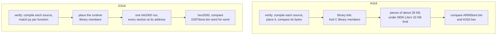

# Building: the byte-exact rebuild of each chip

Each firmware tree rebuilds its vendor image from its sources with the vendor's own compiler and
linker, and compares the result with the original file. The program that does this is the
tree's gate, `tools/gate.py`. A gate that prints IDENTICAL proves that the sources are an exact
description of the shipped firmware. This page says what you need and how to run both gates.

The detailed commands below use A316/D316. A319/D319 use the same compiler families;
their [source and build guide](../../inverters/gen3-lv/docs/319-readability.md) gives the
version-specific commands and acceptance checks. Run from `inverters/gen3-lv/a319` or
`inverters/gen3-lv/d319`, with that tree's local configuration. The ARM acceptance includes
`--place all` and the licensed `--whole` gate; the DSP acceptance includes native and Windows
linkers plus complete coverage. Source names and paths differ from 316.

## What you need

- Python 3.11 or later.
- The toolchains, installed as [toolchains.md](toolchains.md) describes: Keil MDK 5.21 and 5.16,
  ST's StdPeriph V3.5.0 and an [Exhume](https://github.com/abedegno/Exhume) checkout for A316;
  TI's C2000 code generation tools 16.9.6, 15.12.3 and 18.12.8 for D316; Wine for the Windows
  tools.
- The firmware images, which are not in the repository (below).

## Fetch the firmware

```sh
python3 tools/fetch_firmware.py
```

That command selects all manifest packages, including the 318 survey and BMS 3020.
To fetch only the 319 pair, use `python3 tools/fetch_firmware.py --only gen3-lv-319`.
Its inputs are `firmware/gen3-lv/A319_ARMStore.bin`, `A319.hex` and `D319_DSPStore.bin`.

From the repository root. It downloads the package named in
[firmware/manifest.toml](../../firmware/manifest.toml) from the public giv-firmware archive,
pinned to a commit, checks each member against its sha256, writes it under `firmware/`, and makes
the derived A316 HEX file (the ARM image less its 4-byte header) and checks that too. Nothing is
written that fails its check. Options:

| Option | Use |
|---|---|
| `--zip ID=PATH` | use a local copy of the package instead of downloading |
| `--only ID` | fetch one package |
| `--force` | rewrite files that are already in place |

The trees read `firmware/gen3-lv/A316_ARMStore.bin`, `A316.hex` and `D316_DSPStore.bin`.

## Configure

Each tree finds its tools through environment variables or a `toolchain.local.toml` beside its
README (gitignored; start from `toolchain.example.toml`). The environment wins over the file.

| Tree | Settings |
|---|---|
| A316 | `EXHUME`, `MDK_TOOLCHAIN` (or `MDK_HOME` and `MDK_LIBHOME`), `WINE_BIN`; for the licensed modes only, `MDK_LICENSED_HOME` (and `MDK_LICENSED_PREFIX`) ([a316 README](../../inverters/gen3-lv/a316/README.md)) |
| D316 | `C2000_WINEPREFIX`, `C2000_CGT`, `C2000_RTSLIB`, `C2000_NATIVE`, `WINE_BIN` ([d316 README](../../inverters/gen3-lv/d316/README.md); defaults in `toolchain.toml`) |

## Run the gates

```sh
# A316 (ARM)
cd inverters/gen3-lv/a316
$EXHUME/.venv/bin/python tools/gate.py          # the whole gate
$EXHUME/.venv/bin/python tools/gate.py --fast   # only what changed since the last run

# D316 (DSP)
cd ../d316
python3 tools/gate.py                           # the whole gate
python3 tools/gate.py --with try/x.c            # with try/x.c in place of the source of that stem
```

Both gates also take `--with` to test a changed copy of one source without touching `src/`. The
A316 gate has `--verify-only`, `--place` (prove a source by placing armcc's own object) and
`--libhome`; the D316 gate has `--native` (link with the native 18.12.8 linker instead of 15.12's
under Wine). The A316 gate needs Exhume's venv because it imports Exhume's armcc5 profile. Each
gate creates its own Wine prefixes under its `build/` directory and stops its Wine servers when
it ends.



The details are in [A316 gate.md](../../inverters/gen3-lv/a316/docs/gate.md) and the docstring of
the D316 [gate](../../inverters/gen3-lv/d316/tools/gate.py).

## With a licensed MDK: the whole link

**Needs a licensed MDK.** The A316 gate above runs under MDK-Lite and needs no licence; it is
the proof. With a licensed MDK 5.21 or later (any edition without the 32 KB link limit), the
gate can also do the whole proof in one armlink run:

```sh
cd inverters/gen3-lv/a316
$EXHUME/.venv/bin/python tools/gate.py --whole          # about 35 s; --fast and --with work as above
```

It finds the licensed MDK through `MDK_LICENSED_HOME`, or `mdk_licensed_home` in
`toolchain.local.toml`, and runs its tools in the Wine prefix MDK was installed in (its licence
check reads that prefix's registry; `MDK_LICENSED_PREFIX` if it is not the directory above
`drive_c`). Without the setting it prints SKIPPED and exits 0. The licence is never printed or
logged: every line of tool output that names it is dropped.

`--whole` verifies every source with that MDK's armlink, the 45 KB Modbus file included (no
object placement), then links the whole image at once: every proved section FIXED at its
address, Keil's library start-up code and members, the region table and the compressed RW data
(made from the proved sources' RAM sections and the image's own initial RAM). It checks the
listing (every section at its address, nothing between sections but armlink's alignment
padding) and compares the image, `ARMStore.bin` and the HEX: all three must be IDENTICAL.
[A316 gate.md](../../inverters/gen3-lv/a316/docs/gate.md#the-whole-link-with-a-licensed-mdk---whole)
has the scatter layout and the fail tests. Output: `build/whole/report.txt`. The same licensed
MDK runs the mod build ([modding.md](modding.md#the-arm-a316)).

## What the gates print

| Tree | Success | Report |
|---|---|---|
| A316 | `bin: ... IDENTICAL`, `hex: ... IDENTICAL`, then `-- gate: PASS` | `build/gate/report.txt`; `build/gate/coverage.tsv` lists every byte range and what supplied it |
| A316 `--whole` | the same three lines, then `-- gate --whole: PASS` | `build/whole/report.txt` |
| D316 | `IDENTICAL: the linked image is ... word for word`, then `PASS` | a count of the words each kind of source supplied |

Exit status 0 means PASS.

## What IDENTICAL means

IDENTICAL means the linked image is equal to the vendor's file, every byte (A316, including the
4-byte header and the HEX form) or every 16-bit word (D316, including the 0xFFFF holes). And the
gates only pass when every source under `src/` matches on its own as well. Every byte of each
image is accounted for:

| | A316 | D316 |
|---|---|---|
| From proved sources | 143,854 bytes (99.0 %) | 48,555 words (74.1 %) |
| From the toolchain's libraries | 1,208 bytes, Keil's C library | 1,240 words, TI's runtime library |
| Made by the linker | 248 bytes (region table, compressed RW data) and 10 bytes of checked padding | 2 words (the end of .cinit) |
| Fill | | 15,739 words of 0xFFFF |
| Copied from the original | 0 | 0 |

So nothing of the vendor's image is copied in. What IDENTICAL does not mean: it says nothing
about whether the firmware is correct, safe or useful, only that these sources are what GivEnergy
compiled. It is also not a test of any changed source: a change that alters a byte fails the gate
by design ([modding.md](modding.md) is about builds that are meant to differ).

## In CI

GitHub's runners run both gates, `gate.py --whole` and both mod builds, each with a fail test,
on every push to `main` and on pull requests from branches of this repository. The toolchains
come from an encrypted bundle in a private repository. [ci.md](ci.md) has what runs, the
safeguards and how to replace the bundle and rotate its keys.

## Checks without the toolchains

```sh
python3 tools/repocheck.py
```

From the repository root. It needs neither toolchain nor images, and CI runs it on every push and
pull request: every Python
file compiles, every relative Markdown link and anchor resolves, no binary files or Intel HEX
records are tracked, tracked text is ASCII with no home directory paths, and the firmware manifest
is well formed.

## Other tools in the trees

| Tree | Tool | Use |
|---|---|---|
| A316 | `tools/applynames.py` | apply a table of renames to the sources and the map |
| A316 | `tools/objplace.py` | prove a source by placing armcc's object (the 45 KB Modbus file) |
| A316 | `tools/modbuild.py` | the mod build: a changed `ARMStore.bin` in one link (needs a licensed MDK; [modding.md](modding.md#the-arm-a316)) |
| A316 | `tools/emudiff.py` | run functions of a mod build and the original side by side in an emulator |
| A316 | `tools/srcfiles.py` | find a source by stem or address |
| D316 | `tools/dis.py` | disassemble any range or map name |
| D316 | `tools/match.py` | compile one source and compare each function with the image |
| D316 | `tools/coverage.py` | check that the map covers every word once |
| D316 | `tools/ebss_solve.py` | restore a file's variable order after a header change |

Each tree's README has the full list. The toolchain fingerprint searches and the matching tools
are in [Exhume](https://github.com/abedegno/Exhume): its armcc5 profile for A316, its ti-c2000
profile for D316. The scripts the matching work used here were removed after v1.0.0, when every
function was matched; they are in the `v1.0.0` tag.
