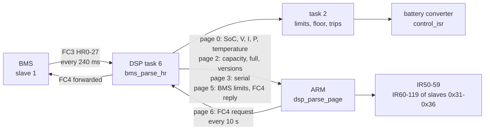
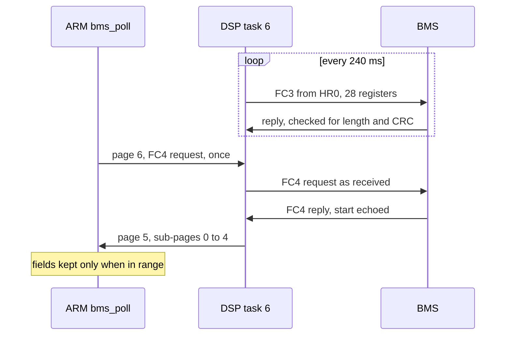

# The battery across both chips

The DSP is the only chip on the battery bus. It polls the BMS, applies the BMS's limits and its
own, and runs the battery converter. The ARM sees the battery only through the DSP's telemetry,
decides when to charge and discharge, and shows the values in its registers. This page is the
system view. The formulas and thresholds are in the two per-tree pages, which I do not repeat:

- [D316 battery.md](../../inverters/gen3-lv/d316/docs/battery.md): the BMS link, every limit and
  taper with its formula, SoC floor, forced charge, voltage trips, soft start, calibration, and
  what a third-party BMS bridge must provide;
- [A316 battery.md](../../inverters/gen3-lv/a316/docs/battery.md): the ARM's pack poll, its
  registers and its SOC. It was written before D316 was decompiled; where it cites an outside
  Ghidra analysis for the DSP side, D316 battery.md now has the answer from matched code.

## The data path

Two polls share the bus:

- **The DSP's own FC3 poll**, every 240 ms ([`task6_bms_link`](../../inverters/gen3-lv/d316/src/app/battery/bms_link.c)):
  28 registers from HR0 with HR109 = 1 (the default), else 9 from HR17. This is what controls
  the battery.
- **The ARM's FC4 pack poll**, one request every 500 `task_measure` passes, about every 10 s
  ([`bms_poll`](../../inverters/gen3-lv/a316/src/app/control/measure.c)): blocks of 21, 19 and
  20 registers from 0, 21 and 40, for devices 1 to 5 in turn. The ARM stages the request on page
  6, the DSP sends it as it is, and returns the reply in up to five 20-byte sub-pages of page 5.
  The ARM only displays this data (cells, temperatures, capacities per pack).

## Who decides what

| Question | Chip | Function |
|---|---|---|
| Is there a BMS? | DSP: HR54 from the ARM (`battery_type`); the BMS "reports" when BMS HR19 bits 0-1 are not both 0 and HR22 is not 0 | `bms_parse_hr`, `soc_floor` |
| Charge and discharge current limits | DSP: BMS HR26/HR27 (or HR25 with BMS firmware 3010 or older), tapered by voltage, capped by HR111/HR112 x capacity + 1.5 A and HR309 | `current_limit_tapers` |
| SoC used for control | DSP: low byte of BMS HR21 | `bms_parse_hr` |
| SoC shown in the app (IR59) | ARM: the DSP's page 0 SoC with HR54 = 1; from the voltage with HR54 = 0 | `task_monitor`, `batt_soc_from_voltage` |
| SoC floor, force charge, no discharge, full | DSP | `soc_floor` |
| Voltage protection | DSP: HR98 trip with a BMS, fixed 56.0/46.0 V regulation without | `batt_voltage_monitor`, `current_controller` |
| When to charge or discharge | ARM | `task_schedule` ([energy-modes.md](energy-modes.md)) |
| Calibration sequencing (HR29) | ARM, advanced by DSP warning bits | `task_dsp_rx` |
| Temperature limit | neither: the DSP counts the battery temperature against 100.0 and never reads the count; the BMS temperature (HR24) only goes to the ARM | `temp_check` ([dc_measure.c](../../inverters/gen3-lv/d316/src/app/meas/dc_measure.c)) |

## Battery settings: the ARM's range and the DSP's

Several battery registers are clamped twice. The ARM's range is what a Modbus write may set; the
DSP's clamp is what acts. Both from the source: `modbus_fc06_write_reg`
([modbus_slave.c](../../inverters/gen3-lv/a316/src/app/comm/modbus_slave.c)) and the page
handlers ([arm_link.c](../../inverters/gen3-lv/d316/src/app/comm/arm_link.c),
[arm_page_write.c](../../inverters/gen3-lv/d316/src/app/comm/arm_page_write.c)).

| Register | ARM accepts | DSP uses |
|---|---|---|
| HR54 battery type | 0..1 | 0 no BMS, else BMS mode |
| HR55 capacity, Ah | 0..10000 | replaced by BMS HR11 after 50 BMS replies |
| HR97 low voltage limit, 0.01 V | 0..65500 | x 0.1, clamped 20.0..48.0 V; x 0.86 during a calibration, x 0.5 with HR175 |
| HR98 high voltage limit, 0.01 V | 0..65500 | x 0.1, clamped 54.0..63.0 V; x 1.05 during a calibration |
| HR109 | 0..100 | 1: full BMS poll, anything else: short poll |
| HR110 SoC reserve, % | 0..99 | sent as the discharge stop SOC (page 4 byte 21) outside discharge slots; the floor in grid modes, and forced discharge stops there |
| HR111, HR112 charge and discharge limit, % | 0..250 | 1..100 |
| HR114 | 0..100 | the floor in other modes |
| HR308 battery power rating, W | 501..6000 | x 10 in 0.1 W, clamped 1.0..6.0 kW; the discharge rating is 300 W more |
| HR309 maximum charge current | 10..80, x 100 | 10.00..80.00 A, the ceiling of the charge cap |

Two things make HR97 and HR98 less settable than they look:

- The ARM resets them to 43.20 V and 58.50 V at every boot (A316 findings item 7).
- In BMS mode only HR98 acts, as the over-voltage trip level; HR97 sets the under-voltage fault
  and the start permit. Without a BMS the converter regulates to a fixed 56.0 V and 46.0 V and
  HR98 does not set the regulation point ([control.md](control.md)).

## Calibration: the bits that end each stage

HR29 runs a battery calibration: discharge until "empty", then charge until "full"
([`sched_charge_discharge_eval`](../../inverters/gen3-lv/a316/src/app/control/schedule_p3.c)).
The ARM advances it from the 16-bit warning word in bytes 7-8 of the DSP's frame
(`task_dsp_rx`). The DSP fills byte 7 with the low byte of `bms_alarm` (BMS HR20) and byte 8
with the low byte of `batt_warning` ([`batt_warning_update`](../../inverters/gen3-lv/d316/src/app/battery/bms_link.c)).
So the three bits the ARM tests are:

| ARM bit | DSP source | Ends |
|---|---|---|
| 0x800 | BMS HR20 bit 3 ("empty") | the discharge stage |
| 0x400 | BMS HR20 bit 2 ("full") | the charge stage |
| 0x002 | `batt_warning` bit 1 = CF15 bit 6, the DSP's battery over-voltage trip | the charge stage |

The A316 notes give this mapping as inference; the D316 source confirms it. Neither chip times a
calibration out. During one, the DSP holds the SoC to HR110 + 1 .. 99 and the BMS limits to at
least 8.00 A, and drops the full, force-charge and no-discharge blocks
([D316 battery.md](../../inverters/gen3-lv/d316/docs/battery.md)).

The other warning bits: `batt_warning` bit 2 is CF15 bit 2 (under-voltage), bit 3 CF15 bit 5
(soft-start timeout), bit 5 CF15 bit 9 (BMS comms), bit 7 CF17 bit 6 (charger over-temperature).
The high bytes of `bms_alarm` and `batt_warning` are not sent (D316 findings-comm).

## Charge status

Byte 2 of the DSP's frame, `arm_charge_status`
([arm_link.c](../../inverters/gen3-lv/d316/src/app/comm/arm_link.c)), first match wins:

| Value | When |
|---|---|
| 7 | CF15 bit 1: the measured and BMS voltages disagree, or the voltage is very low |
| 6 | any `batt_warning` bit |
| 0 | the converter is off (`conv_mode` 0) |
| 5 | discharging |
| 4 | SoC 98 % or more |
| 3 | SoC above 90 % |
| 2 | SoC above 4 % |
| 1 | otherwise |

The ARM serves it as IR14, stops charging and discharging at 7, and shows IR0 = 2 at 6 unless
HR351 is 1.

## HR175, the low-battery wake

HR175 asks the DSP to force a charge and to wake the BMS: the DSP writes BMS HR1 = 1 every 5 s,
halves its HR97 copy, and after 200 frames with the battery between 40.0 and 46.0 V sets
`low_batt_wake`, which lets the converter start without the BMS's permit and regulate the
battery terminal to 56.0 V from PV ([D316 battery.md](../../inverters/gen3-lv/d316/docs/battery.md)).
On the ARM, HR175 sends the PV start voltage as 155.0 V (the DSP clamps it to 150.0 V) and the
state byte as "charge", and clears itself after 300 page-4 frames with the battery voltage above
540 and current above 1000 in the ARM's units (5.40 V and 10.00 A)
([`dsp_build_page`](../../inverters/gen3-lv/a316/src/app/comm/dsp_link.c)). The DSP's fall of
HR175 sets CF15 bit 3 for 10 s and stops the state machine.

## HR332: lead acid on one chip, a burn-in on the other

HR332 = 1 on the ARM sets HR54 to 0 (no BMS), the capacity to 125 Ah, HR305 to 1, and the
settings byte the ARM sends on page 2 byte 39 to 1 (`modbus_fc06_write_reg`). On the DSP that
byte is `aging_test_enable`: after 2 s it forces a charge (aging mode 1, both PV inputs at 160 V
or more, with the PV references fixed at 250.0 V) or a discharge (mode 2), and turns the 63.0 V
fast trip off
([`aging_test_update`](../../inverters/gen3-lv/d316/src/app/power/power_limits.c), D316
findings-control item 3). So the register the ARM documentation calls lead-acid mode puts the DSP
into what its code treats as a test mode. Which reading GivEnergy intended is open.

## Lead acid and no-BMS operation

With HR54 = 0 the DSP does not poll the BMS, its limits are 60.00 A before the caps, and the
current controller regulates the battery voltage to 56.0 V on charge and 46.0 V on discharge
(50.0 V and 54.0 V in the aging modes). The ARM computes the SoC from the voltage between HR97
and HR98 (`batt_soc_from_voltage`, A316 findings item 23 for its division).

## Faults that stop the battery

Any CF15 bit is a battery fault: it stops the battery converter and its soft start. The bits,
from [`batt_voltage_monitor`](../../inverters/gen3-lv/d316/src/app/power/power_limits.c) and
[`bms_link.c`](../../inverters/gen3-lv/d316/src/app/battery/bms_link.c), are listed in
[fault-bits.md](../reference/fault-bits.md#cf15-battery-faults). Two to know:

- CF15 bit 5, the soft-start timeout after 160 s, is never cleared until the DSP restarts (D316
  findings-power item 1).
- CF15 bit 9, the BMS comms fault, comes after 30 s without a good reply and clears on the first
  good one.

## See also

- [energy-modes.md](energy-modes.md): when the ARM asks for charge or discharge.
- [../findings.md](../findings.md): the battery findings ranked with the rest.
