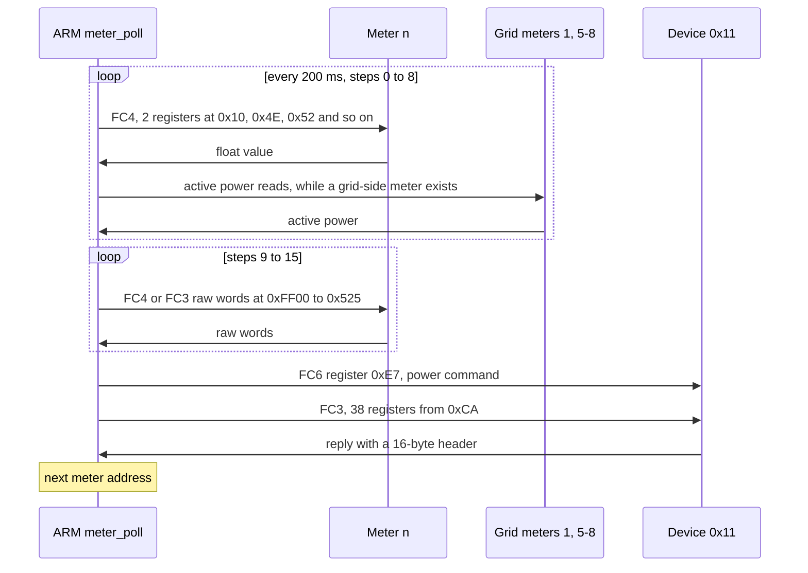
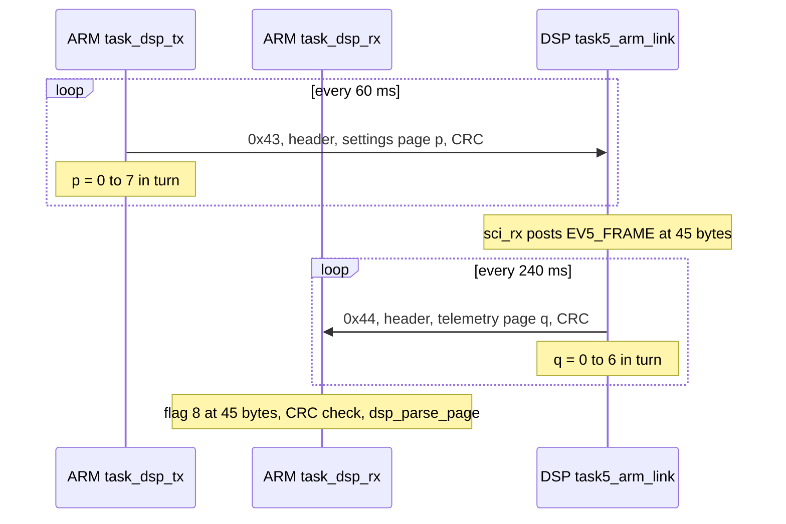

# Communication: Modbus slave, meters, ARM-DSP frames

Three protocols run on the ARM and one more on the DSP. This page describes each as the code
does it. The byte layouts are in [reference/arm-dsp-link.md](../reference/arm-dsp-link.md) and
[reference/registers.md](../reference/registers.md); the per-tree pages are
[A316 comm.md](../../inverters/gen3-lv/a316/docs/subsystems/comm.md),
[A316 usb.md](../../inverters/gen3-lv/a316/docs/subsystems/usb.md) and
[D316 arm_link.md](../../inverters/gen3-lv/d316/docs/subsystems/arm_link.md).

## The Modbus slave (ARM)

One handler, [`modbus_slave_process`](../../inverters/gen3-lv/a316/src/app/comm/modbus_slave.c),
serves two transports:

- **USB CDC**, the WiFi or LAN dongle, 57600 8N1. Each block the dongle sends is one request;
  replies go back with `CDC_SendData`. So the app and the cloud use this slave.
- **RS485** on USART3 at 9600, polled by `task_modbus_rs485` every 5 ms, driver enable on PB4.

Frames, as the code reads and writes them:

| Frame | Layout |
|---|---|
| request FC3, FC4, FC6, FC22 | slave, function, start or register (2), count or value (2), CRC (2) |
| request FC16 | slave, function, start (2), count (2), count x 2 data bytes, CRC (2): no byte count |
| reply | slave, function, the 10-character inverter serial, start (2), count (2), data, CRC |
| error reply | the same 16-byte header with function or 0x80, then the CRC |

Function 22 (0x16) is GivEnergy's own: it reads the meter records.

Rules:

- A read is limited to 60 registers and may not cross a multiple of 60.
- The CRC order: over USB an 8-byte request carries its CRC low byte first (standard Modbus) and
  an FC16 request high byte first; over RS485 every request must carry it high byte first.
  Replies are always low byte first. So a standard Modbus master on RS485 is refused
  (A316 findings item 14; whether this is meant depends on GivEnergy's own RS485 tools).
- Writes to slave 0 over RS485 get no reply.
- A refused register ends an FC16 write with the error reply; the registers before it stay
  written.
- Reads outside the served ranges (HR540-4079, HR4200-4339, HR4400 and up, IR300 and up, FC22
  from 120) use an uninitialised length for the CRC and can corrupt RAM (A316 findings item 3).

Slaves answered: the inverter's own address (HR30), 0, 1 to 8 (the meters' views), 0x11, 0x30
(system), 0x31 (battery unit), 0x32 to 0x36 (battery packs 1 to 5) and 0x37. On RS485 the task
takes only first bytes equal to HR30, 1 to 8 and 0x30 to 0x36. The input registers 60 to 119
differ by slave ([registers.md](../reference/registers.md)).

### The dongle watchdog

`sys_tick_1s` ([schedule_p3.c](../../inverters/gen3-lv/a316/src/app/control/schedule_p3.c)):
after 60 s without a good request it sends a 302-byte block to the dongle (stale stack bytes,
A316 findings item 5); after 12 minutes it switches the OTG clock off and restarts USB.

## The meter master (ARM)

[`task_meter`](../../inverters/gen3-lv/a316/src/app/comm/meter.c) every 5 ms, on USART2 at 9600,
8N1 for HR47 = 1 or 8E1 for HR47 = 0, driver enable PA4. HR7 is a bit mask of the meters present
at addresses 1 to 8.

From `meter_poll`. The nine FC4 values per meter are voltage, current, frequency, active power,
one more value, apparent power, power factor, and import and export energy. A reply is taken by
the step that sent the request, not by the register in the reply. Meter 1 is the grid connection,
meters 2 and 3 AC-coupled PV, meter 4 a load, meters 5 to 8 sources subtracted from the grid
power (inference from `power_flow_update`). HR48 and HR49 reverse single meters.

A meter silent for 2000 passes (10 s) sets the meter fault: IR0 reads 2, IR57 reads 1, the meter
values are cleared, and the DSP gets the flag on page 4, which stops the mode 0 battery command
([energy-modes.md](energy-modes.md)).

The device at 0x11 speaks GivEnergy's framing with the CRC high byte first. Its registers are
served as HR202 to HR231. What it is (an export limiter, a diverter or a charger) is not in the
code.

The same task rebuilds the register images HR0-59 and IR0-59 every fifth pass, 25 ms
(`modbus_regs_update`).

## The ARM-DSP frames

Both directions: 45 bytes, a CRC-16/MODBUS over bytes 0 to 42 sent high byte first in bytes 43-44
(the reverse of Modbus RTU's order; both ends agree). The ARM's frames: `task_dsp_tx`, which
sends only when the last frame has gone (flag 0x10 from the UART4 transmit interrupt) and no
firmware relay runs. The DSP's: `task5_arm_link` on every fourth 60 ms tick, when SCI-A has
finished sending.

Link health:

- **ARM side.** 50 bad CRCs, or 50 wake-ups without a frame, set `FAULT_DSP_LINK` (0x80) and
  reset the receive buffer; any good page clears it.
- **DSP side.** A good frame clears the fail count, and 40 good frames clear CF18 bit 2. A bad
  CRC or a wake-up without a frame counts; at 300 CF18 bit 2 is set again (a stop fault). After
  CF18 bit 2 has been set for 10 minutes, the DSP raises GPIO27, a reset request by inference
  (`status_led_and_reset`).
- **A DSP fault.** `sci_rx` clears task 5's pending events on every ARM byte, so ticks and frame
  events can be lost while a frame arrives (D316 findings-comm item 1).

The firmware updates reuse the same port with other framing: 0x0A frames for the DSP boot
loader, "BMS" frames for the battery relay ([update-packages.md](../system/update-packages.md)).

## The BMS link (DSP)

[`task6_bms_link`](../../inverters/gen3-lv/d316/src/app/battery/bms_link.c), every 40 ms, sends
one request every sixth tick (240 ms) to slave 1 on SCI-B at 9600 8N1, with GPIO57 raised while
sending. In order of priority: FC6 writes of BMS HR1 (the HR175 wake), HR4 (HR201), HR2 (a
pending battery update) or HR3 (HR200); a request the ARM forwards on page 6; or the FC3 poll.
Replies are accepted only with byte 0 below 0x10, function 3 or 4, the exact length and a good
CRC (low byte first). 30 s without a good reply sets the comms fault. Details and the register
meanings: [battery.md](battery.md) and [D316 battery.md](../../inverters/gen3-lv/d316/docs/battery.md).

## The auxiliary MCU (ARM)

USART1 at 9600 receives pages from an auxiliary MCU: the CT current waveform, the DRM inputs and
the battery NTC (`aux_uart_rx_byte`, [stm32f10x_it.c](../../inverters/gen3-lv/a316/src/app/stm32f10x_it.c)).
Its protocol is in the A316 sources; its firmware is not in this repository.
