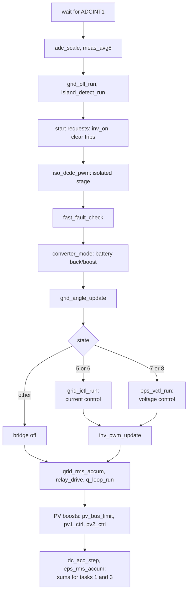
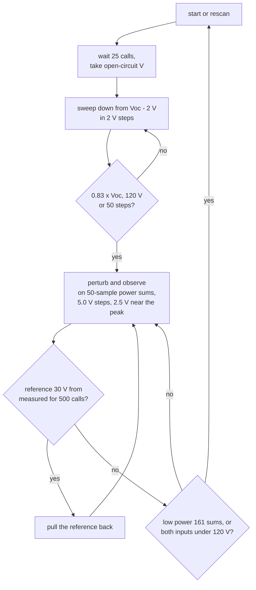

# Control: the interrupt, the loops and MPPT

The DSP's power control runs in one interrupt at 19.2 kHz and in four 10 to 20 ms tasks that set
its references and limits. This page gives the structure; the gains, limits and units are in
[D316 control.md](../../inverters/gen3-lv/d316/docs/subsystems/control.md),
[meas.md](../../inverters/gen3-lv/d316/docs/subsystems/meas.md) and
[power.md](../../inverters/gen3-lv/d316/docs/subsystems/power.md). Where I say what the hardware
does, that is inference from the code.

## Timing

| What | Rate | Source |
|---|---|---|
| `control_isr` | 19.2 kHz, ePWM4 at counter zero (period 2343, up-down, 90 MHz) | [converter_ctrl.c](../../inverters/gen3-lv/d316/src/app/control/converter_ctrl.c) |
| slow loops in the interrupt | 2.4 kHz, on fixed slots of an 8-sample cycle (`ctrl_slot`) | `meas_avg8` |
| `grid_period_isr` | once a grid cycle, eCAP1 | converter_ctrl.c |
| `tz_trip_isr` | on a hardware trip | converter_ctrl.c |
| task 1, AC measurement | each grid cycle and every 20 ms | [ac_measure.c](../../inverters/gen3-lv/d316/src/app/meas/ac_measure.c) |
| task 2, battery limits and command | 20 ms | [power_limits.c](../../inverters/gen3-lv/d316/src/app/power/power_limits.c) |
| task 3, DC measurement and MPPT | 10 ms and each nominal cycle | [meas_task.c](../../inverters/gen3-lv/d316/src/app/meas/meas_task.c), [dc_measure.c](../../inverters/gen3-lv/d316/src/app/meas/dc_measure.c) |
| task 4, grid code | 20 ms | [grid_support.c](../../inverters/gen3-lv/d316/src/app/grid/grid_support.c) |

A 50 Hz cycle is 384 samples, a 60 Hz cycle 320 (`grid_freq_setup`).

| Slot | Runs on it |
|---|---|
| 0 | the grid controller's bus voltage PI; PV1's MPPT voltage PI |
| 1 | PV2's MPPT voltage PI |
| 2 | the PV boost precharge of the bus (start state only) |
| 4 | the battery converter's outer loops (`current_controller`) |
| 6 | the PV bus limiter (`pv_bus_limit`) |

## The interrupt, in order

From `control_isr`; the order is the image's.

## The loops

**Grid current control** (states 5 and 6, `grid_ictl`). The outer loop is a PI on the DC bus
voltage (slot 0) that gives the active current amplitude, limited by the bounds task 4 writes
every 20 ms. The inner loop runs every sample: a proportional term on the current error, a
repetitive filter over one grid period, and the grid voltage plus a lead term as feed-forward.
So on the grid the bridge regulates the DC bus, and the power limits act as a clamp on its
current.

**EPS voltage control** (states 7 and 8, `eps_vctl`). The amplitude ramps to the RMS reference
that task 1 sets (50.0 V up to nominal at 10.0 V a cycle, then a slow trim of up to 50.0 V). A
voltage loop (proportional only: `eps_vctl_init` sets ki to 0) with a repetitive filter and a
load feed-forward gives a current reference of up to 37.0 A, and a current loop gives the duty.

**PLL** (`pll_step`, [pll.c](../../inverters/gen3-lv/d316/src/app/control/pll.c)). Single phase:
the voltage times cos(theta), two low-pass stages, an incremental PI to the angle step, limited
to 25 to 80 Hz. 20 good cycles lock it, 10 bad ones unlock it. The outputs lead by 2.8 degrees,
which I read as delay compensation (inference).

**The battery converter.** Two stages ([hardware.md](../system/hardware.md)). The isolated stage
runs at the duty the soft start sets. ePWM5 is controlled by `current_controller`
([current_ctrl.c](../../inverters/gen3-lv/d316/src/app/control/current_ctrl.c)): in the grid
states it follows task 2's current command (slewed 0.1 A a slot, held to 15.0 A), in the EPS
states it holds the DC bus. Then it applies, in order, the command limits, the battery voltage
loops (only without a BMS), task 2's charge and discharge bounds, and the full-battery trim. A
current PI on the high-side current plus the feed-forward `pwm_period x hv_v / bus_v` gives the
duty, held to 500..2300 counts.

**Without a BMS (HR54 = 0)** the current controller caps charging at a fixed 56.0 V and floors
discharging at 46.0 V; with a BMS it has no battery voltage loop at all, and only the HR98 trip,
the 63.0 V fast trip and the BMS limits act on the voltage
([D316 control.md](../../inverters/gen3-lv/d316/docs/subsystems/control.md), the section on the
0xC208/0xC20A limits).

**PV boosts.** `pv1_ctrl` and `pv2_ctrl` every sample: a current PI under the MPPT voltage PI
(on its slot) and under the bus limiter's cap. `pv_bus_limit` holds the bus at its reference
+10.0 V (EPS) or +20.0 V (grid) by capping both PV currents, and clamps the MPPT references to
120.0..545.0 V.

## Fast faults

`fast_fault_check` runs every sample. It trips the PWM at once for an inverter current of 40.0 A,
a DC bus over 585.0 V, a high-side current of 20.00 A, a high-side voltage of 560.0 V, a battery
over 63.0 V for more than 40 samples (off while HR332 is set), a grid voltage peak of 396.0 V,
and any battery fault. `tz_trip_isr`, the hardware trip zone, forces every PWM off and sets
CF12 bit 4. The table with counts and actions is in
[D316 control.md](../../inverters/gen3-lv/d316/docs/subsystems/control.md); the faults they set
are in [fault-bits.md](../reference/fault-bits.md).

## MPPT

`pv_mppt_step` ([mppt_step.c](../../inverters/gen3-lv/d316/src/app/power/mppt_step.c)) runs from
task 3 once per slow average, in states 5 and 7, and calls `mppt_pv1` and `mppt_pv2`
([mppt.c](../../inverters/gen3-lv/d316/src/app/power/mppt.c)) by PV mode (independent or
parallel).

The PV2 drift test is 20 V for 250 calls. Aging mode 1 (HR332) fixes both references at 250 V.
Task 3 also limits PV power: derated 0.06 %/V above a derate voltage, 0.2 %/V more than 40 V
above it, 24 % above 545.0 V ([D316 meas.md](../../inverters/gen3-lv/d316/docs/subsystems/meas.md)).

## Measurement

The interrupt scales the 16 ADC results (`adc_scale`), takes 8-sample means with a notch at 99 Hz
(119 Hz on a 60 Hz grid) on the bus, which removes the double-line-frequency ripple (`meas_avg8`), and accumulates per-cycle sums for task 1 (RMS of the grid
voltage, inverter voltage, currents, residual current; power; DC injection) and task 3 (the DC
channels). Task 1 measures frequency from the median of three eCAP periods and runs a PI that
trims task 4's power limit against the measured power. The ADC result map is in
[hardware.md](../system/hardware.md#the-adc-results).

## See also

- [grid.md](grid.md): what task 4 does with the measurements.
- [battery.md](battery.md): where the battery bounds come from.
