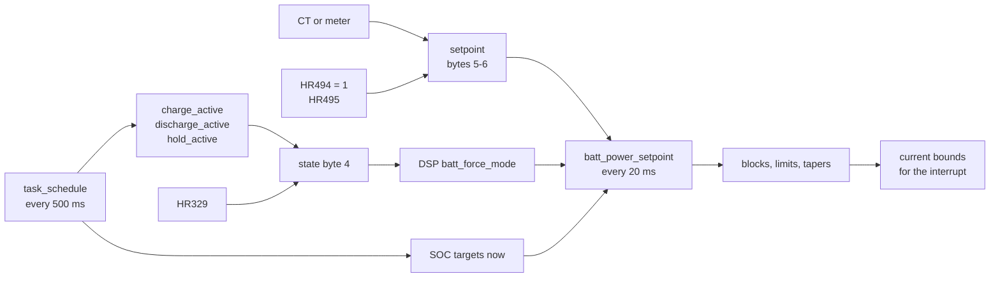

# Energy modes: from settings to DSP commands

The app offers eco mode, timed charge and discharge, export limits and remote control. None of
these is a mode in the firmware as such. The ARM turns the settings and the clock into a handful
of values every 500 ms, sends them in its frames, and the DSP turns those into a battery power
command every 20 ms. This page follows that chain.

## What the ARM sends

| Frame place | Value | Set by |
|---|---|---|
| header byte 4 | the battery state: 0 normal, 1 charge, 2 discharge | `task_dsp_tx` ([dsp_link.c](../../inverters/gen3-lv/a316/src/app/comm/dsp_link.c)) |
| header bytes 5-6 | the power setpoint, signed | `task_dsp_tx` |
| page 0 byte 24 | HR27, `battery_power_mode` (1 while table mode holds) | `dsp_build_page` |
| page 0 bytes 22, 23 | `charge_active`, `discharge_active` | `dsp_build_page` |
| page 4 byte 21 | `discharge_min_soc_now`, the discharge stop SOC (4 under HR329) | `sched_slot_soc_targets` |
| page 7 byte 16 | `charge_target_soc_now`, the charge stop SOC | `sched_slot_soc_targets` |
| page 7 bytes 12-15, 20, 21 | HR308 battery power rating, HR309 maximum charge current, HR313 and HR314 forced charge and discharge rates | settings |
| page 4 bytes 19, 20 | HR111 and HR112, the charge and discharge limits in % | settings |

Byte 4 is chosen in this order: 2 while HR329 forcing is on; else 1 while `charge_active` or HR175
is set; else 2 while `discharge_active`; else 0.

The setpoint in bytes 5-6 is HR495 when HR494 is exactly 1 (remote mode). Otherwise it is
`-batt_power_calc / 10`, where `batt_power_calc` is the CT power without meters, or minus the net
grid meter power with them ([`power_flow_update`](../../inverters/gen3-lv/a316/src/app/control/monitor.c)).

## How the ARM decides

[`task_schedule`](../../inverters/gen3-lv/a316/src/app/control/schedule_p3.c), every 500 ms:

1. **Table mode** (HR322 = 1): `sched_halfhour_table_eval` reads the current half hour's value
   from two 48-entry tables (HR420-467 and HR360-407). It discharges when the first is above both
   HR323 and HR325, charges when the second is below HR324, and otherwise sets `hold_active`. A
   price table fits, but the code shows only numbers (inference). The tables are kept in RAM only,
   so after a restart they read 0 and, with HR324 above 0, every half hour charges (A316 findings
   item 12).
2. Otherwise, at DSP charge status 7 (a battery fault), nothing is charged or discharged.
3. Otherwise **the normal mode**, `sched_charge_discharge_eval`:
   - **Charge slots.** Ten slots (HR94/95, then nine more in EEPROM block 6), each HHMM start and
     end, end minute included, start equal to end meaning off, start after end wrapping past
     midnight. `charge_active` while any slot is active, HR96 = 1 and the inverter on grid
     (`sched_charge_slots_eval`).
   - **Discharge slots.** Ten slots (HR56/57, HR44/45, then eight more), with HR59 = 1, on grid,
     no charge active, and not with HR110 = 100 and HR27 = 1 together (`sched_discharge_slots_eval`).
   - **Calibration** (HR29 not 0, on grid): discharge until the DSP reports "empty", then charge
     until it reports "full" ([battery.md](battery.md)).
   - **Night recovery** (HR29 = 0): from 01:00 to 04:59, a battery flat for 30 s is charged for
     HR108 minutes, once a night (`batt_night_recovery_charge`).
   - A charge always cancels a discharge.
4. **SOC targets** (`sched_slot_soc_targets`): the charge target is the active charge slot's SOC,
   else HR310; the discharge stop is the active discharge slot's SOC, else HR110. In remote mode
   (HR494 = 1) they are HR310 and HR114.

"On grid" is `sys_mode` = 1, which is DSP page 0 byte 28: 1 when the DSP has no grid fault
(`arm_link_frame`, [arm_link.c](../../inverters/gen3-lv/d316/src/app/comm/arm_link.c)). That
settles an open question in the A316 notes, which followed the public register list for IR49.

**HR329 forcing** is outside this order: it makes byte 4 2 (discharge) and the discharge stop
4 % whatever the slots say, and `task_schedule` clears it after 2 hours with the DSP's SOC below
10 %.

## How the DSP turns it into a command

[`batt_power_setpoint`](../../inverters/gen3-lv/d316/src/app/power/power_limits.c), task 2,
every 20 ms. The force mode is byte 4 as received, with three overrides: HR175 or aging mode 1
force mode 1, aging mode 2 forces mode 2, and mode 1 falls back to 0 when HR20 is 1, PV is faulted
and the SoC is above HR116.

A command is worked out only in states 5 and 6 (on the grid) with no battery fault; elsewhere it
is 0.

| Mode | Command (0.1 W, positive = charge) | Stops |
|---|---|---|
| 0, normal | when the setpoint changes: minus the measured battery power, minus half the setpoint; 0 while HR27 is 0 or CF19 bit 2 is set; held to plus or minus HR308 | nothing of its own |
| 1, forced charge | HR308 x HR313 %, at most capacity x HR111 % x the battery voltage | at `charge_target_soc_now` with a BMS, unless BMS HR15 bit 0 is set |
| 2, forced discharge | -(HR308 + 300 W) x HR314 %, at most capacity x HR112 % x V in size | at or below `discharge_min_soc` with a BMS |

Then, in order: a grid frequency or voltage response replaces the command while it is active
([grid.md](grid.md)); until the grid soft-start ramp is done the size is held to its limit; the
blocks apply (force charge, no discharge, full); and the current command is 10 x P / V on the
high side, held to plus or minus 15.0 A. The limits and tapers are in [battery.md](battery.md).

### Mode 0 is the self-consumption loop

In mode 0 the setpoint is the ARM's grid reading, not a battery power. The DSP's export check reads
it the same way: a setpoint below minus the export limit counts as exporting too much
([`export_overload_check`](../../inverters/gen3-lv/d316/src/app/grid/grid_support.c)). So with
export negative, each new reading moves the command by half the export towards charging, and by
half the import towards discharging. That is a self-consumption ("eco") loop with a gain of 0.5
per reading. The reading of the sign convention is inference from these two uses; the code does
not state it.

Consequences:

- **HR27 = 0** turns mode 0 off: the battery idles outside forced charge and discharge.
- **The meter link.** Page 4 byte 28 carries the meter fault (or the aux link fault without
  meters). The DSP keeps it in CF19 bit 2, which makes the mode 0 command 0
  ([fault-bits.md](../reference/fault-bits.md)). Without a working CT or meter the battery does not
  follow the house.
- **Remote mode** (HR494 = 1) puts HR495 where the grid reading would be. So HR495 is not a
  battery power but a stand-in for the grid reading: HR495 = -1000 gives a command 5000 units
  (500 W if the unit is 0.1 W) further towards charging than the measured battery power
  (inference from the formula). The command is recomputed only when
  the value changes.
- **Table mode's hold** sends HR27 as 1, so a "hold" half hour is mode 0, self-consumption, not a
  fixed battery.

## Export and import limits

| Setting | Effect | Where |
|---|---|---|
| HR26 `grid_port_max_power` | the export limit, sent x 10 (at least 1200); 6000 while a calibration runs | page 2 bytes 35-36; `power_limits_update`, `export_overload_check` |
| HR178 | export limit on (`grid_func_flags` bit 0) | page 6 byte 38 |
| HR101, HR102 bit 6 | the import limit in A, and its switch | page 7 bytes 17, 26-27 |
| HR50 `active_power_rate` | output power in % of rated (capped by the DRM limit for grid codes 2 and 3) | header byte 3 |
| HR27 with the 0x11 device | the ARM commands the device at Modbus 0x11 with 36000 while HR230 = 1 (the default), else with the export power when HR27 = 1, the export is above 50 W and no slot is active | `dev11_power_cmd_update` ([meter.c](../../inverters/gen3-lv/a316/src/app/comm/meter.c)) |

The DSP narrows its grid current bounds by the export and import limits
([`power_limits_update`](../../inverters/gen3-lv/d316/src/app/grid/grid_support.c)); details are
in [grid.md](grid.md). With the charge target on (HR20) and the SoC at HR116 after the start
ramp, the import side is held at -0.5 A, so the grid does not charge the battery past the target.

## The schedule window

HR318 to HR320 make one more window: between the times HR319 and HR320 the ARM sends HR318 on
page 7 byte 28 (`sched_window_value`). The DSP acts on three values
(`current_limit_tapers`, `soc_floor` in [power_limits.c](../../inverters/gen3-lv/d316/src/app/power/power_limits.c)):

| HR318 | DSP effect |
|---|---|
| 1 | charge bound 0.25 A: no charging in practice |
| 2 | discharge bound -0.25 A: no discharging in practice |
| 3 | CF15 bit 15, a battery fault: the battery converter stops |

## RAM-only registers

HR481 to HR490 are copies of HR27, HR29, HR56, HR57, HR59, HR94, HR95, HR96, HR50 and HR53 that
are not saved to EEPROM, and HR166 = 1 keeps most schedule and battery writes in RAM
([A316 comm.md](../../inverters/gen3-lv/a316/docs/subsystems/comm.md)). HR175, HR200, HR201,
HR329, HR360-467, HR495 and HR4000 are never saved, and HR494 is saved only when another block 6
write saves it (A316 findings item 24). Inference: these are for frequent remote control without
wearing the EEPROM.

## See also

- [battery.md](battery.md): the limits the command passes through.
- [../reference/registers.md](../reference/registers.md): the registers named here.
