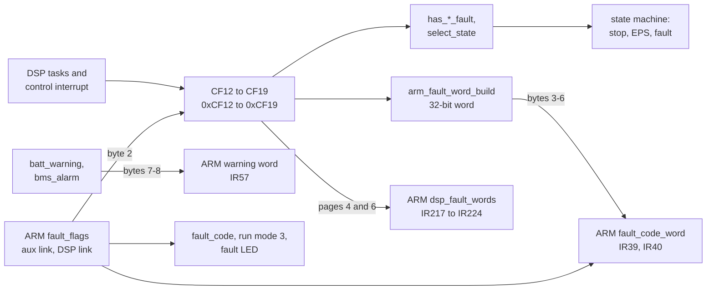

# Faults: where they come from and where they go

Almost every fault the inverter reports is detected on the DSP. The DSP keeps them in eight
16-bit words, CF12 to CF19, and sends them to the ARM in three forms. The ARM has only two fault
bits of its own. This page follows the path; every bit is listed in
[reference/fault-bits.md](../reference/fault-bits.md).

## The path

## On the DSP

Each task sets and clears its own bits ([faults.h](../../inverters/gen3-lv/d316/src/include/faults.h));
`state_init` clears them all once at start-up and sets four that the measurements must clear
([startup.md](startup.md)). The words group the faults by what they stop
([`has_*_fault`](../../inverters/gen3-lv/d316/src/app/state/op_states.c)):

| Word | Group | Effect |
|---|---|---|
| CF12 high byte, CF13, CF14 low byte | grid faults | the grid states go to EPS or idle; no grid start |
| CF14 high byte | EPS faults | the EPS states go to idle |
| CF15 | battery faults | the battery converter and its soft start stop |
| CF16 | PV faults | state 5 resets the PV control; the request moves to 6 or 8 |
| CF17, CF18 low byte | stop faults | state 3 until they clear |
| CF18 high byte | from the ARM | requests state 3 through `select_state`, though `has_stop_fault` does not count it |
| CF19 | battery blocks | limits on the battery command (full, force charge, no discharge, no mode 0 power) |

Task 3 turns the groups into events for the state machine every 10 ms
([meas_task.c](../../inverters/gen3-lv/d316/src/app/meas/meas_task.c)), and task 1's
`select_state` uses them for the run mode request ([states.md](states.md)). The fast faults in the
control interrupt also stop the converters at once, before any task runs
([control.md](control.md)).

## Three forms on the link

1. **The 32-bit fault word**, header bytes 3-6, every frame. `arm_fault_word_build`
   ([arm_link.c](../../inverters/gen3-lv/d316/src/app/comm/arm_link.c)) copies eight stop faults
   into it: CF17 bit 11 to bit 17, CF18 bit 6 to 19, CF18 bit 2 to 21, CF17 bit 3 to 22, CF17
   bit 1 to 25, CF17 bit 0 to 27, CF17 bit 4 to 28, CF17 bit 7 to 31. Grid, EPS, battery and PV
   faults are not in it.
2. **The raw words**, pages 4 and 6. CF12 to CF16 on page 4 bytes 33-42 and CF17 to CF19 on
   page 6 bytes 13-18, each low byte first. Each page comes every 1.68 s.
3. **The warning word**, header bytes 7-8: the low bytes of `bms_alarm` (BMS HR20) and
   `batt_warning` (from CF15 and CF17 bit 6), [battery.md](battery.md).

Plus the charge status in byte 2 (7 for a battery voltage mismatch, 6 for any battery warning)
and the run mode in byte 1 (3 in the fault state).

## On the ARM

[`task_dsp_rx`](../../inverters/gen3-lv/a316/src/app/comm/dsp_link.c) takes the header of each
good frame:

- `fault_code_word` = the DSP's 32-bit word with bits 6 to 11 replaced by the ARM's own
  `fault_flags` bits 6 to 11. Served as IR39 (high half) and IR40 (low half) by
  `modbus_ir_update` ([meter.c](../../inverters/gen3-lv/a316/src/app/comm/meter.c)).
- `dsp_warning_word` = bytes 7-8, served as IR57; forced to 0 by HR351 = 1, and IR57 reads 1
  while the meter fault is set.

[`dsp_parse_page`](../../inverters/gen3-lv/a316/src/app/comm/dsp_link.c) keeps the raw words in
`dsp_fault_words[16]`, in the order they arrive; with HR351 = 1 bytes 6 and 7 (CF15, the battery
faults) are stored as 0. `modbus_fc04_read_input`
([modbus_slave.c](../../inverters/gen3-lv/a316/src/app/comm/modbus_slave.c)) serves them two bytes
to a register as IR217 to IR224. Since the DSP sends each word low byte first and the ARM puts
the first byte in the register's high byte, **IR217 to IR224 are CF12 to CF19 with their bytes
swapped**: CF12 bit 12 (grid voltage) is IR217 bit 4.

The ARM's own fault bits ([faults.h](../../inverters/gen3-lv/a316/src/include/faults.h)):

| Bit | Name | Set | Cleared |
|---|---|---|---|
| 0x40 | `FAULT_AUX_LINK` | no page from the auxiliary MCU on USART1 for 1000 `task_monitor` passes (20 s) on grid, 10000 (200 s) off grid | its next good page |
| 0x80 | `FAULT_DSP_LINK` | 50 bad frames, or 50 wake-ups of `task_dsp_rx` without a frame | any good page |
| 0x100 | | only by `fault_debounce_count`, which has no caller | |

`fault_code` is the number of the lowest set bit (`fault_code_update`, [monitor.c](../../inverters/gen3-lv/a316/src/app/control/monitor.c)),
and any bit but `FAULT_AUX_LINK` puts the ARM's run mode to 3 (`fault_check_mode`). The fault LED
follows `fault_code`. The fault and event logs in EEPROM are cleared, loaded and saved, but never
written: their push functions have no caller (A316 findings, dead code).

The ARM also sends `fault_flags >> 4` to the DSP in header byte 2. The DSP turns bit 2 (the aux
link, 0x40) into CF18 bit 8 and bit 4 (0x100) into CF18 bit 9
([`arm_frame_parse`](../../inverters/gen3-lv/d316/src/app/comm/arm_link.c)). The DSP-link bit
0x80 becomes bit 3 of byte 2, which the DSP does not read.

### A cross-chip effect

Put together, the code says that a silent auxiliary MCU stops the inverter, although the ARM
alone says it should not: the ARM leaves its run mode alone for `FAULT_AUX_LINK`, but the bit
reaches the DSP as CF18 bit 8, and `select_state` requests state 3 for any bit in CF18's high
byte. The DSP stays in state 3 while the request is 3. I have not seen this on an inverter; it is
the two sources read together, and whether the aux link ever goes quiet in service is not in the
code. It is in [findings.md](../findings.md).

## What the app shows

The app and the cloud read the registers through the dongle. Which registers GivEnergy's app
turns into which message is not in either firmware. What the firmware provides:

| Register | Content |
|---|---|
| IR0 | run mode: 0 idle or starting, 1 running, 2 meter fault (or charge status 6 with HR351 = 0), 3 fault, 4 update |
| IR14 | charge status 0 to 7 |
| IR39, IR40 | the 32-bit fault word, with the ARM's bits 6 to 11 |
| IR57 | the warning word (BMS HR20 low byte, `batt_warning`) |
| IR217 to IR224 | CF12 to CF19, bytes swapped |
| IR225 onwards | the CEI 0-21 auto test results |

## See also

- [../reference/fault-bits.md](../reference/fault-bits.md): every bit.
- [states.md](states.md): what each group does to the state machine.
