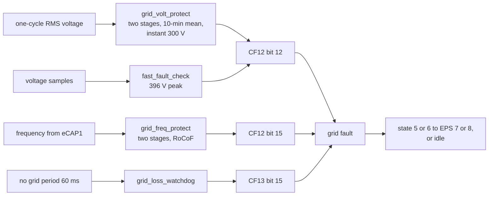

# The grid: codes, protection and support

All grid protection and grid support runs on the DSP, in task 4 every 20 ms
([`grid_support.c`](../../inverters/gen3-lv/d316/src/app/grid/grid_support.c)) and in the control
interrupt. The ARM holds the settings and the per-country tables, and sends them on pages 0 to 3
and 6 to 7. This page connects the two; the thresholds are in
[D316 grid.md](../../inverters/gen3-lv/d316/docs/subsystems/grid.md) and
[rcmu.md](../../inverters/gen3-lv/d316/docs/subsystems/rcmu.md).

Units on the DSP: voltage 0.1 V, frequency 0.01 Hz, power 0.1 W, times in 20 ms ticks unless a
setting is in ms.

## Grid codes

The grid code is the high byte of HR2. The ARM uses it to pick a row of its country tables
(`grid_load_country_limits`, [board.c](../../inverters/gen3-lv/a316/src/app/board.c)), which fill
HR63 to HR83, the trip limits and times; 29 rows, codes 0 to 28. The DSP gets the code on page 0
byte 8, maps 20 and 21 to 3, and tests it in groups
([`arm_page0`](../../inverters/gen3-lv/d316/src/app/comm/arm_link.c)):

| Group | Codes | What sets it apart |
|---|---|---|
| Italy | 4 | the CEI 0-21 auto test, its own frequency and voltage logic |
| Australian-style | 3, 19 (and 20, 21 via 3) | volt-watt 253-260 V or 242-250 V, latched under-frequency response |
| European-style | 2, 9, 11, 13, 22-26, 28 | RoCoF, fixed Q(U) curves, cos phi(P) 0.9 |
| PT1 code | 7 | PT1 smoothing of Q, its own export overload check |
| fixed OF recovery | 8, 12, 16, 17 | over-frequency recovery at 50.20/60.20 Hz |

Neither firmware names a country. That 4 is Italy rests on the CEI 0-21 test sequence in the
code; that 3 and 19 are Australia and New Zealand rests on volt-watt points that match AS/NZS
4777.2. Both are inference ([D316 grid.md](../../inverters/gen3-lv/d316/docs/subsystems/grid.md)).
I have not matched any code to the UK's G98/G99.

The low byte of HR2 is the model: 50, 46 and 36 give the 5.0, 4.6 and 3.6 kW presets on the DSP
(`arm_page0`, `rating_apply`), and the ARM serves HR0 as 0x2001, 0x2002 or 0x2003 for the same
three bytes (`modbus_hr_update`, [meter.c](../../inverters/gen3-lv/a316/src/app/comm/meter.c)).
An unknown model sets CF17 bit 10 and runs the 2 kW preset.

How the ARM writes the limits matters: `cfg_limit_check`, which `modbus_fc06_write_reg` calls for
HR63-66, HR71-74 and HR79-82, accepts every value, and HR28 = 1 (60 Hz) adds 10.00 Hz to every
frequency limit. The DSP clamps some of them: HR64 and HR72 to 230.0..315.0 V, HR63 and HR71 to
0..230.0 V ([reference/arm-dsp-link.md](../reference/arm-dsp-link.md)).

## Protection

| Check | Settings | Fault |
|---|---|---|
| over- and under-voltage, two stages each | HR64/HR68, HR63/HR67, HR72/HR76, HR71/HR75 | CF12 bit 12 |
| 10-minute mean voltage | HR83 | CF12 bit 12 |
| instantaneous | 300.0 V (276.0 V for code 18), 2 ticks | CF12 bit 12 |
| voltage peak, in the interrupt | 396.0 V for more than 76 samples (4 ms) | CF12 bit 12 |
| over- and under-frequency, two stages each | HR66/HR70, HR65/HR69, HR74/HR78, HR73/HR77 | CF12 bit 15 |
| RoCoF (European group) | 1.10 Hz over 26 samples, about 2.2 Hz/s | CF12 bit 15 |
| grid lost | no grid period for 3 ticks (60 ms) | CF13 bit 15 and a grid fault event |
| reconnect window, off the grid | HR79-HR82 | CF14 bit 7 until 2 s inside |
| DC injection, after 60 s on the grid | `dci_limit`, `dci_trip_time` | CF17 bit 0 |
| residual current | below | CF18 bit 6 |
| momentary cessation (some codes) | HR315, HR316 | the bridge stops, the state stays |

A voltage fault clears after 2 s inside the stage 1 window, a frequency fault after 5 s. A grid
fault in state 5 or 6 moves the inverter to EPS, if EPS is enabled and the battery allows it
([states.md](states.md)).

Two oddities from the findings: the RoCoF detector starts from a previous frequency of 0, so it
trips once on the first valid measurement for the European codes (D316 findings-control item 6);
and several trip counters add up samples over the limit since the last trip rather than
consecutive samples (item 7).

## Anti-islanding

Three mechanisms, all on the DSP:

- **Active frequency shift.** `island_detect` ([island_detect.c](../../inverters/gen3-lv/d316/src/app/control/island_detect.c))
  once a grid cycle takes the PLL's frequency drift over three cycles and feeds 50 x that, up to
  1.5 A, into the reactive current reference: positive feedback that pushes the frequency away
  once the grid is gone. 60 cycles with a large drift stop the bridge.
- **Passive protection**: the frequency and voltage stages and RoCoF above.
- **Grid-loss watchdog** in task 1: 60 ms without a grid period.

That the first is an anti-islanding scheme is my reading of a positive-feedback loop on the
frequency with a trip on drift (inference).

## Grid support

### Active power

`power_limits_update` takes the smallest of: the soft-start ramp, P(f) over-frequency, the
temperature derate, volt-watt, the DC-side derates, the rated power, the room left beside Q, and
HR50 % of rated. The grid current bounds follow from it, narrowed by the export limit (HR26 with
HR178) and the import limit (HR101 with HR102 bit 6)
([D316 grid.md](../../inverters/gen3-lv/d316/docs/subsystems/grid.md)).

### Frequency and voltage responses

In state 5 (with PV) they limit the output power; in state 6 (battery only) they replace the
battery power command, so the battery itself responds:

| Response | Settings | Codes |
|---|---|---|
| over-frequency, P(f) | start HR321, droop HR123, delay HR300, recovery HR328 and HR303 | most |
| under-frequency | start HR326, droop HR327, delay HR312 | European, 3, 19 |
| over-voltage (battery) | over 253.0 V: -1 % of rated every 1.4 s to -85 % | European |
| under-voltage (battery) | under 215.0 V (224.0 V for 19): cut charging | 3, 19 |
| Italy | its own `freq_response_it` | 4 |

### Reactive power

Q mode is HR122 (page 0 byte 27):

| HR122 | Mode |
|---|---|
| 1 | fixed power factor from HR52 |
| 2 | cos phi(P), from 50 % load |
| 3 | PF(P) curve: never acts, because the curve's power points are never set (D316 findings-control item 1) |
| 4, 5 | fixed Q, HR51 % of rated |
| 6 | Q(U) on HR138-HR141, with lock-in and lock-out (HR142, HR143) for some codes |
| 8, 9 | fixed Q(U) bands, European group |

Q is limited to 60 % of rated, and the output filter capacitor's own reactive power (8.4 uF from
the constant) is added.

## DRM

The demand response inputs come from the auxiliary MCU on the ARM's USART1. For grid codes 3, 20
and 21 (and 2, 8, 12 in another form), with HR41 = 1, `drm_mode_eval`
([monitor.c](../../inverters/gen3-lv/a316/src/app/control/monitor.c)) turns them into a power
limit of 2, 40, 70 or 100 % and a DRM0 request. The ARM caps HR50 by the limit for codes 2 and 3,
and replaces HR53 by DRM0 for codes 2, 3, 20 and 21 on page 0. The lists disagree between the
functions (A316 findings item 16).

## The residual current monitor (RCMU)

On the DSP, run from task 4 and the control interrupt
([rcmu.c](../../inverters/gen3-lv/d316/src/app/rcmu/rcmu.c),
[D316 rcmu.md](../../inverters/gen3-lv/d316/docs/subsystems/rcmu.md)):

1. **Zero offset**, after task 4 has run 10 s.
2. **Self test**, about 5 s: the test circuit is closed with GPIO52 and the reading must move by
   0.02 to 0.15 A. A second failed restart disables the RCMU until the next start, and the idle
   state will not start the inverter in modes 5 and 6 while the RCMU is enabled and the test has
   not passed.
3. **Watch**, in states 5 and 6, after 22 s of settling:

| Check | Level in the code | Time in the code |
|---|---|---|
| continuous | 300 mA (RMS or the DC mean) | more than 10 runs (220 ms) |
| sudden step 30 mA | 27 mA | 10 runs (about 200 ms) |
| sudden step 60 mA | 54 mA | 3 runs (about 60 ms) |
| sudden step 150 mA | 135 mA | at once; also every 0.52 ms in the interrupt |

The step levels are 0.9 x VDE 0126-1-1's; the continuous one is set to 0.3 A on every run, so it
is 300 mA, not 270 mA. A trip sets CF18 bit 6, a stop fault. The switches come from HR1 (page 0
bytes 15-16), each bit inverted by `arm_page0`: HR1 bit 1 set turns the RCMU off, and the step
checks run only while HR1 bit 4 is set (`rcmu_watch_step`). The default of HR1 is not in the
ARM's defaults code I read, so I cannot say which way an inverter ships.

## The CEI 0-21 auto test

For grid code 4 the ARM can start an eight-step self test of the protection stages
(`auto_test_state` on page 1 byte 42). The DSP moves a test value step by step until each stage
trips and reports the step, value, trip time and result on telemetry page 4, which the ARM serves
as IR225 onwards ([D316 grid.md](../../inverters/gen3-lv/d316/docs/subsystems/grid.md)).
