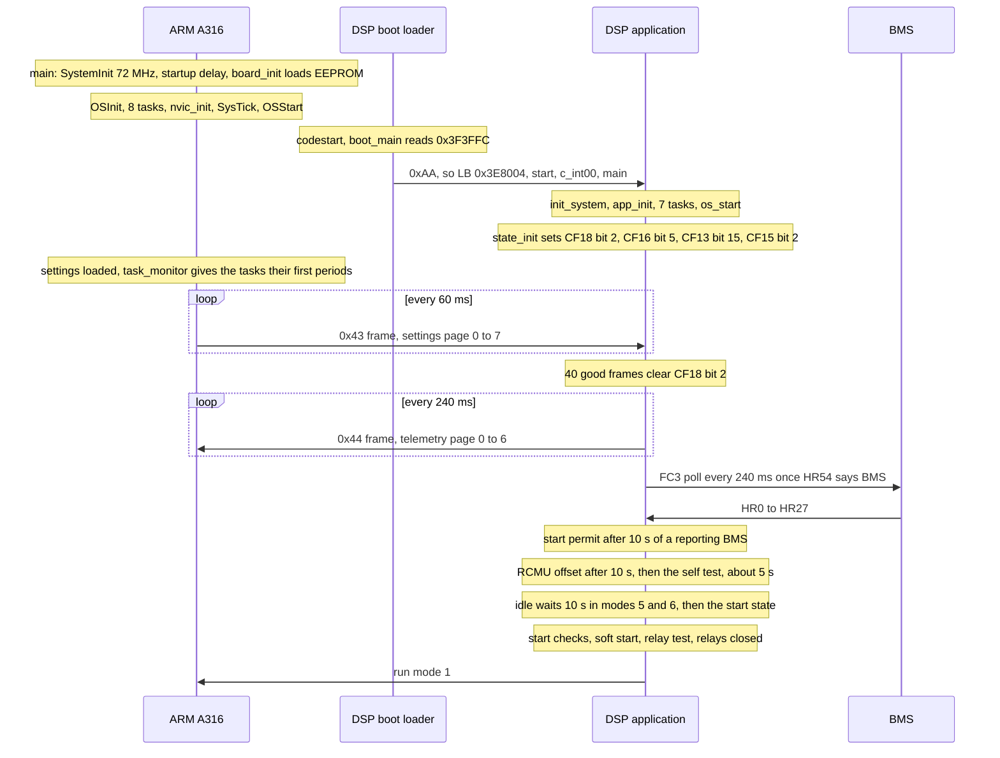

# Start-up: power-on to running

Both chips come out of reset on their own. The ARM loads its settings and starts its tasks; the
DSP's boot loader checks one word and starts the application, which waits in its idle and fault
states until the ARM's frames, the measurements and the battery let it choose a run mode. This
page follows both, from the code.

## The sequence

The timings are those of the code; the order of the lines on the two sides is not fixed, since
the chips start independently.

## The ARM

[`main`](../../inverters/gen3-lv/a316/src/app/main_p1.c), called by Keil's `__rt_entry` after the
C library has copied and cleared RAM:

1. `SystemInit` sets the clock to 72 MHz. Interrupts are masked.
2. `sys_startup_delay` runs 20 million empty loop passes. What it waits for is not in the code; my
   guess is the DSP's own start ([A316 main.md](../../inverters/gen3-lv/a316/docs/subsystems/main.md)).
3. `board_init` ([board.c](../../inverters/gen3-lv/a316/src/app/board.c)): the panel, LED, buzzer
   and I2C pins, the settings from the EEPROM (`cfg_load_all`), TIM3, the ADC with DMA, the four
   UARTs at 9600 and the run-time variables.
4. `OSInit`, then eight `OSTaskCreate` calls, task 5's period set to 20.
5. `nvic_init` (vector table at 0x08014000, priorities, interrupts on), `OS_CPU_SysTickInit`
   (1 ms), `OSStart`.

`OSStart` runs `task_usb` first, because no task is ready yet and the scheduler falls back to
task 7. Only tasks 5 and 7 have periods. When the settings are loaded, `task_monitor` gives the
others a first wait: 20 ms for the DSP transmitter, 150 ms for the DSP receiver, 1 s for
`task_measure`, 500 ms for the scheduler and USB, 1.5 s for the Modbus slave and the meters.
So the link to the DSP starts first. USB host mode starts 10 s after boot
([A316 rtos.md](../../inverters/gen3-lv/a316/docs/subsystems/rtos.md)).

What `cfg_load_all` does at every boot matters for owners
([A316 drivers.md](../../inverters/gen3-lv/a316/docs/subsystems/drivers.md)):

- each EEPROM block is read up to five times; a failed block gets its defaults and is re-read at
  2 s and 4 s before the defaults are written over it;
- HR53 (inverter on) is set to 1;
- calibration gains outside 0.70 to 1.30 are reset to 1.0;
- HR97 and HR98, the battery voltage limits, are set to 43.20 V and 58.50 V, every boot in this
  image (A316 findings item 7).

## The DSP

At reset the F2806x boot ROM jumps to `codestart` at 0x3F7FF6
([CodeStartBranch.asm](../../inverters/gen3-lv/d316/src/ti/CodeStartBranch.asm)), which branches
to [`boot_main`](../../inverters/gen3-lv/d316/src/boot/boot_main.asm):

1. GPIO ports A and B become inputs without pull-ups.
2. The word at 0x3F3FFC is read. If it is 0xAA, the watchdog goes off, RAM blocks M0, M1 and L0
   to L8 are cleared, and the boot loader jumps to the application at 0x3E8004. Anything else
   enters the update loader and waits for the ARM ([update-packages.md](../system/update-packages.md)).
3. `start` turns the watchdog off again and runs `c_int00`, TI's C start-up, which copies the
   initialised data (.cinit) and calls `main`.

[`main`](../../inverters/gen3-lv/d316/src/rtos/os_main.c):

1. `init_system` ([device_init.c](../../inverters/gen3-lv/d316/src/drivers/device_init.c)): clocks
   (PLL x 9 / 2, 90 MHz), the PIE, the ramfuncs copied from flash 0x3F1BB7 to RAM 0x8000,
   `InitFlash` from RAM, GPIO, ADC, DMA, the two SCIs, CPU timer 2, eCAP1; every PWM tripped
   off; `InitEPwm`; then `adc_offset_measure` (a 500 ms wait, then 128 conversions for the zero
   offsets). Interrupts stay off.
2. `app_init` ([app_init.c](../../inverters/gen3-lv/d316/src/app/state/app_init.c)): the serial
   rings, "no BMS" (`battery_type` 0), the PV and DC-DC start words, `settings_defaults` and
   `init_defaults` (5 kW, 230 V 50 Hz, 120 Ah, HR97/HR98 42.0/56.0 V), the RCMU.
3. `os_init`, seven tasks with their periods and staggered first counts, `EINT`, `ERTM`,
   `os_start`.

Task 0 then runs [`state_init`](../../inverters/gen3-lv/d316/src/app/state/op_states.c), which
clears the fault words and sets four bits that the measurements must clear:

| Bit | Meaning | Cleared by |
|---|---|---|
| CF18 bit 2 | ARM link lost | 40 good ARM frames (`task5_arm_link`), about 2.4 s |
| CF16 bit 5 | no PV | task 3's PV detection |
| CF13 bit 15 | grid lost | the grid-loss watchdog in task 1 |
| CF15 bit 2 | battery under-voltage | `batt_voltage_monitor` (task 2) |

CF18 bit 2 is a stop fault, so the DSP passes through its fault state (run mode 3 to the ARM)
until the ARM's frames are in.

## From idle to running

The DSP chooses its run mode every 20 ms in [`select_state`](../../inverters/gen3-lv/d316/src/app/meas/ac_measure.c)
from the ARM's command and its own fault words ([states.md](states.md)). For the common case,
grid with PV:

1. **Battery.** The ARM's page 0 carries HR54. With a BMS (HR54 = 1) task 6 polls it every
   240 ms; the start permit comes after 10 s of a reporting BMS with its pack voltage (BMS
   HR22) above HR97 minus 2.0 V; `soft_start_permit` follows when the high side reads 220.0 V or more, or after 120 s
   without a battery fault ([battery.md](battery.md)).
2. **RCMU.** Task 4 measures the residual current sensor's zero for 10 s, then runs the
   self test, about 5 s ([grid.md](grid.md)).
3. **Idle.** [`state0_idle`](../../inverters/gen3-lv/d316/src/app/state/op_states.c) waits 501
   passes (10 s) in run modes 5 and 6 and needs the RCMU test passed; other modes start at once
   (or after 30 s while HR175 waits for the battery to wake).
4. **Start.** `start_grid_pv` counts down `connect_countdown` (HR61, the start time, or HR62,
   the restart delay, x 50 passes) while the grid is in its reconnect window; below 1000 it
   soft-starts the battery converter (or precharges the bus from PV with a battery fault); below
   750, with the bus up, the PLL locked and the frequency found, it runs the relay test; at the
   end it closes the relays and returns state 5.
5. **Run.** The ARM sees run mode 1 in byte 1 of the 0x44 frame, and turns its output enable on
   20 `task_measure` passes after frame byte 9 (`run_status_bits` bit 3, set by the relay test)
   allows it ([A316 control.md](../../inverters/gen3-lv/a316/docs/subsystems/control.md)).

With no PV (at night CF16 bit 5 stays set), the request is mode 6, grid on battery only, which
needs the battery and has no PV start.

## See also

- [states.md](states.md): the states and their transitions.
- [../system/update-packages.md](../system/update-packages.md): the other branch of `boot_main`.
