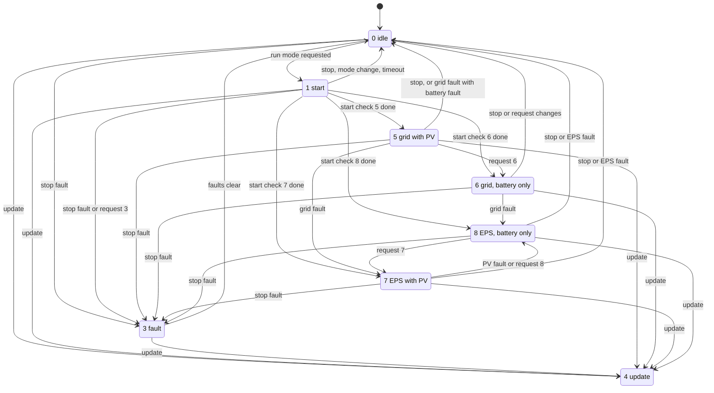
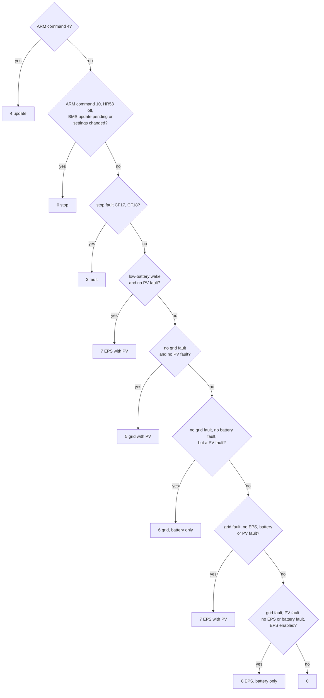

# Operating states and run modes

The DSP owns the inverter's state. Its task 0 runs a state machine; task 1 picks, every 20 ms,
which run mode the state machine should aim for. The ARM's "run mode" is mostly the DSP's state
reported back, with two values of its own.

## The DSP's states

[`task0_state_machine`](../../inverters/gen3-lv/d316/src/app/state/state_task.c) calls the
function of `op_state` (0xCF0D) for ever; each state function waits for events and returns when
it picks the next state ([op_states.c](../../inverters/gen3-lv/d316/src/app/state/op_states.c),
names in [state.h](../../inverters/gen3-lv/d316/src/include/state.h)).

| State | Name | Function | What it does |
|---|---|---|---|
| 0 | `OP_IDLE` | `state0_idle` | stops the converters, waits for a run mode request |
| 1 | `OP_START` | `state1_start` | runs the start check of the requested mode each tick |
| 3 | `OP_FAULT` | `state3_fault` | everything off until the stop faults clear |
| 4 | `OP_UPDATE` | `state4_update` | everything off, then the boot loader's update; never returns |
| 5 | `OP_GRID_PV` | `state5_grid_pv` | on the grid with PV, `conv_mode` 5 |
| 6 | `OP_GRID_BATT` | `state6_grid_batt` | on the grid, battery only, `conv_mode` 6 |
| 7 | `OP_EPS_PV` | `state7_eps_pv` | EPS (off-grid output) with PV, `conv_mode` 7 |
| 8 | `OP_EPS_BATT` | `state8_eps_batt` | EPS, battery only, `conv_mode` 8 |

There is no state 2.

Details the diagram leaves out:

- **Idle to start.** Requests 5 and 6 wait 501 passes (10 s) and need the RCMU self test passed
  (or the RCMU off). Other requests go at once, except that with HR175 set and the BMS answering
  they wait up to 1501 passes (30 s) for the battery to wake (`state0_idle`).
- **Start checks.** `start_grid_pv`, `start_grid_batt`, `start_eps_pv` and `start_eps_batt` return
  0 (idle) when the request changes or their countdown runs out, 3 on a stop fault, 4 on an
  update. Grid with PV can start with a battery fault: it then precharges the bus from PV and
  runs without the battery ([battery.md](battery.md)).
- **Grid to EPS.** On a grid fault, states 5 and 6 close relays b and c, stop the bridge, wait
  one 11 ms tick, start the bridge in EPS mode and go to 7 or 8 directly, without the start
  state. State 5 goes to idle instead if there is a battery fault.
- **PV faults in state 5** reset the PV control and stay in state 5; the request then moves to 6.
- **Fault to idle** needs both: no stop fault (CF17, CF18 low byte) and a request other than 3.
- **Update** has no way out: `state4_update` calls `boot_update` with interrupts off, which never
  returns.

In each run state, on every tick, `soft_start` keeps the battery converter's start sequence going
while `soft_start_enable` is 1, and `conv_mode` is the state's number once it reports done, else
0. A battery fault at run time therefore sets `conv_mode` 0 without leaving the state.

### Events

The states react to events that other tasks post ([os.h](../../inverters/gen3-lv/d316/src/include/os.h),
[D316 rtos.md](../../inverters/gen3-lv/d316/docs/subsystems/rtos.md)):

| Event | Posted by |
|---|---|
| `EV0_STOP_FAULT` | task 3, when `has_stop_fault` (CF17, CF18 low byte) |
| `EV0_GRID_FAULT` | task 3 and the grid-loss watchdog (task 1) |
| `EV0_PV_FAULT` | task 3, when `has_pv_fault` (CF16) |
| `EV0_EPS_FAULT` | task 3, when `has_eps_fault` (CF14 high byte) |
| `EV0_STOP` | the fast faults in the control interrupt, ARM run command 10, the aging test switch, the BMS link (around HR175), task 1 and task 3 checks |
| `EV0_UPDATE` | `arm_run_command`, on the 6th frame with ARM run command 4 |
| `EV0_BOOT` | `state4_update` itself, after 100 ticks |

## The run mode request

[`select_state`](../../inverters/gen3-lv/d316/src/app/meas/ac_measure.c) runs in task 1 every
20 ms and writes `run_mode_req`. The first rule that matches wins:

"Grid fault" is CF12 high byte, CF13 or CF14 low byte; "EPS fault" CF14 high byte; "battery
fault" CF15; "PV fault" CF16; "EPS enabled" is 0xD7C0 bit 9. CF18 high byte also counts as a
stop fault here, although `has_stop_fault` does not include it
([fault-bits.md](../reference/fault-bits.md)).

Two consequences an owner may notice:

- With no PV at night (CF16 bit 5 set), a healthy system on the grid is in mode 6, not 5.
- HR53 = 0 (inverter off) makes the request 0 for every grid code. For grid code 4 the ARM also
  sends command 10 in byte 1 (`task_dsp_tx`), which opens all three relays (`relays_off_when_disabled`).

## The ARM's run mode

The ARM keeps `inv_run_mode` ([dsp_link.c](../../inverters/gen3-lv/a316/src/app/comm/dsp_link.c),
[monitor.c](../../inverters/gen3-lv/a316/src/app/control/monitor.c)):

| Value | Meaning | Set by |
|---|---|---|
| 0 | idle or starting | the DSP's frame byte 1 (`arm_run_mode`: states 0 and 1) |
| 1 | running | the DSP's frame byte 1 (states 5 to 8) |
| 3 | fault | the DSP's frame byte 1 (state 3), or `fault_check_mode` when any ARM fault bit other than the aux link one is set |
| 4 | firmware update | the DSP's frame byte 1 (state 4), or `task_dsp_rx` when a DSP update starts |
| 10 | stop, sent only | `task_dsp_tx` sends 10 in byte 1 instead of the run mode for grid code 4 with HR53 = 0 |

The ARM sends its run mode back in byte 1 of every 0x43 frame. The DSP stores it
(`arm_run_mode_set`) and acts only on 4 and 10 (`arm_run_command`, `select_state`).

IR0, the inverter status register, is the run mode, except that it reads 2 while the meter fault
is set, or while the DSP's charge status is 6 with HR351 = 0 (`modbus_ir_update`,
[meter.c](../../inverters/gen3-lv/a316/src/app/comm/meter.c)).

## See also

- [startup.md](startup.md): the first pass through idle and start.
- [faults.md](faults.md): where the fault words come from.
