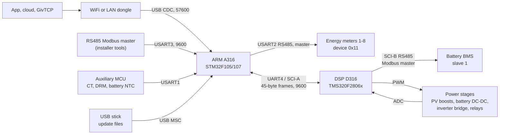
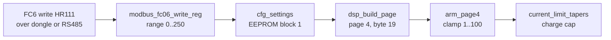
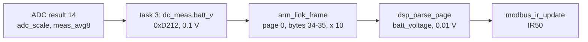

# Architecture: two chips and their links

The Gen3 LV inverter runs two firmwares on two processors. GivEnergy ships them together in
update packages named after both versions; this repository holds A316 and D316 from
`A316-D316.zip`.

- The **ARM** (A316, an STM32F105/107 Cortex-M3) is the controller and the inverter's face to the
  outside: settings, schedules, the Modbus slave, the meters, USB.
- The **DSP** (D316, a TI TMS320F2806x C28x with FPU) runs the power conversion and is the only
  chip that talks to the battery's BMS.

They meet on one serial link. Everything the ARM knows about the battery and the power stage
arrives in the DSP's telemetry frames; everything the DSP knows about settings and schedules
arrives in the ARM's settings frames.

## Block diagram

The pins and ports are from `board.c` ([A316 drivers](../../inverters/gen3-lv/a316/docs/subsystems/drivers.md))
and `device_init.c` ([D316 drivers](../../inverters/gen3-lv/d316/docs/subsystems/drivers.md)).
That the RS485 slave port is for installer tools is inference: the code does not say who is on it.

## What each chip decides

| Decision | Chip | Where |
|---|---|---|
| When to charge, discharge or hold (slots, table mode, calibration, night recovery) | ARM | [`sched_charge_discharge_eval`](../../inverters/gen3-lv/a316/src/app/control/schedule_p3.c), `sched_halfhour_table_eval` |
| The SOC targets for the active slot | ARM | `sched_slot_soc_targets` (schedule_p3.c) |
| The grid power measurement used for self-consumption | ARM (CT or meter) | [`power_flow_update`](../../inverters/gen3-lv/a316/src/app/control/monitor.c) |
| Battery power and current command, limits, tapers, SoC floor | DSP | [`task2_control`](../../inverters/gen3-lv/d316/src/app/power/power_limits.c) |
| Grid protection, grid-code responses, reactive power | DSP | [`grid_support.c`](../../inverters/gen3-lv/d316/src/app/grid/grid_support.c) (task 4) |
| Which operating state to be in (grid, EPS, fault, update) | DSP | [`select_state`](../../inverters/gen3-lv/d316/src/app/meas/ac_measure.c), [`op_states.c`](../../inverters/gen3-lv/d316/src/app/state/op_states.c) |
| The PWM, control loops and fast trips | DSP | [`control_isr`](../../inverters/gen3-lv/d316/src/app/control/converter_ctrl.c) |
| Settings storage, the clock, logs, LEDs | ARM | `board.c`, `eeprom.c`, `rtc.c`, `monitor.c` |
| Firmware updates of the DSP and the battery | ARM starts them, DSP and BMS take them | [`usbh_usr.c`](../../inverters/gen3-lv/a316/src/app/usb/usbh_usr.c), [`boot_flash_loader.c`](../../inverters/gen3-lv/d316/src/boot/boot_flash_loader.c) |

The ARM never sets a current. It decides three flags (charge, discharge, hold), two SOC targets
and a power setpoint, and passes the battery settings on. The DSP turns those into a power
command and applies every limit ([A316 control.md](../../inverters/gen3-lv/a316/docs/subsystems/control.md)).

## The ARM-DSP link

The ARM's UART4 (PC10/PC11) and the DSP's SCI-A (GPIO28/29) at 9600 baud, 8N1. Both directions
use 45-byte frames: a type byte (0x43 from the ARM, 0x44 from the DSP), a header of command or
status bytes, a page number, a page of data, and a CRC-16/MODBUS over bytes 0 to 42, high byte
first.

- The ARM sends a 0x43 frame every 60 ms ([`task_dsp_tx`](../../inverters/gen3-lv/a316/src/app/comm/dsp_link.c),
  task 2), with settings pages 0 to 7 in turn, so each page every 480 ms.
- The DSP sends a 0x44 frame on every fourth 60 ms tick, every 240 ms
  ([`task5_arm_link`](../../inverters/gen3-lv/d316/src/app/comm/arm_link.c)), with telemetry
  pages 0 to 6 in turn, so each page every 1.68 s.

The same port carries the DSP firmware update (frames that start 0x0A) and, through the DSP,
the battery firmware relay. Every byte of both frame types is in
[reference/arm-dsp-link.md](../reference/arm-dsp-link.md).

## The outside links

| Link | Chip, port | Role | Code |
|---|---|---|---|
| WiFi or LAN dongle | ARM, USB OTG FS in host mode, CDC class, 57600 8N1 | Modbus slave | `USBH_USR_EnumerationDone` sets the receive callback to `modbus_slave_process` ([usb.md](../../inverters/gen3-lv/a316/docs/subsystems/usb.md)) |
| RS485 Modbus | ARM, USART3, DE on PB4, 9600 | Modbus slave | [`task_modbus_rs485`](../../inverters/gen3-lv/a316/src/app/comm/modbus_slave.c) |
| Meter bus | ARM, USART2, DE on PA4, 9600 8N1 or 8E1 by HR47 | Modbus master to meters 1-8 and device 0x11 | [`task_meter`](../../inverters/gen3-lv/a316/src/app/comm/meter.c) |
| Auxiliary MCU | ARM, USART1, 9600 | CT waveform, DRM inputs, battery NTC | `aux_uart_rx_byte` ([stm32f10x_it.c](../../inverters/gen3-lv/a316/src/app/stm32f10x_it.c)) |
| USB stick | ARM, USB OTG FS, MSC class, FatFs | update files, serial number | `USBH_USR_MSC_Application` |
| Battery BMS | DSP, SCI-B (GPIO23/18), driver enable GPIO57, 9600 8N1 | Modbus master to slave 1 | [`task6_bms_link`](../../inverters/gen3-lv/d316/src/app/battery/bms_link.c) |

The dongle and the RS485 port reach the same handler, so the app, the cloud and local tools see
the same registers. The two differ in one rule: on RS485 the request's CRC must be high byte
first, which a standard Modbus master does not send
([comms.md](../operation/comms.md), A316 findings item 14).

## How a setting travels

A setting written from the app reaches the power stage in four hops. This is the path of
HR111, the battery charge limit, as an example.

The ARM accepts 0 to 250 (`modbus_fc06_write_reg`, [modbus_slave.c](../../inverters/gen3-lv/a316/src/app/comm/modbus_slave.c));
the DSP's page handler holds it to 1 to 100 ([`arm_page4`](../../inverters/gen3-lv/d316/src/app/comm/arm_link.c));
task 2 uses it for the charge cap ([D316 battery.md](../../inverters/gen3-lv/d316/docs/battery.md)).
Many settings have such a second clamp on the DSP side, so the range the ARM accepts is not
always the range that acts. [reference/registers.md](../reference/registers.md) lists both where
the code has both.

## How a measurement travels

The battery voltage the app shows comes the other way:

The scale is from [`adc_scale`](../../inverters/gen3-lv/d316/src/app/meas/adc_scale.c) (0.1792 x 0.1 V
per count); the page byte from `arm_link_frame`; the register from `modbus_ir_update`
([meter.c](../../inverters/gen3-lv/a316/src/app/comm/meter.c)). The BMS's own pack voltage
(BMS HR22) is used by the DSP for its checks, but it is not what IR50 shows. Measurements are
not always passed on unchanged: the battery power on page 0 is the DSP's value x 1.03 when
charging and x 0.97 when discharging (`arm_link_frame`).

## Software structure on each chip

Both chips run a small cooperative scheduler of their vendor's own with uC/OS-style names. On
neither does an interrupt switch tasks; a task keeps the CPU until it waits.

| | ARM A316 | DSP D316 |
|---|---|---|
| Tick | SysTick, 1 ms | CPU timer 2, 1 ms |
| Tasks | 8: measure, DSP rx, DSP tx, Modbus RS485, meter, monitor, schedule, USB | 7: state machine, AC measure, control, DC measure, grid, ARM link, BMS link |
| Highest priority | task 0, `task_measure` | task 0, `task0_state_machine` |
| Idle | task 7, `task_usb`, runs when nothing else is ready | task 0 is resumed when nothing is ready |
| Hard real time | interrupts: ADC, UARTs, SysTick | `control_isr` at 19.2 kHz from ePWM4 |
| Detail | [A316 rtos.md](../../inverters/gen3-lv/a316/docs/subsystems/rtos.md), [main.md](../../inverters/gen3-lv/a316/docs/subsystems/main.md) | [D316 rtos.md](../../inverters/gen3-lv/d316/docs/subsystems/rtos.md) |

## See also

- [hardware.md](hardware.md): the MCUs, peripherals and power stages.
- [../operation/startup.md](../operation/startup.md): how both chips come up.
- [../operation/comms.md](../operation/comms.md): the protocols in more detail.
