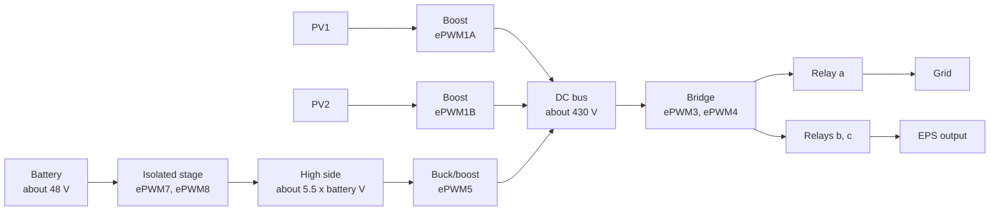

# Hardware, as the code shows it

I have not traced the board. Everything here is what the firmware configures and drives: the
peripherals each chip sets up, the pins it uses, and the power stages its control code implies.
What a pin or a stage is in the circuit is inference from how the code uses it, and I mark it so.

## The ARM: STM32F105/107

| Item | Value | Evidence |
|---|---|---|
| Part | STM32F105/107, the connectivity line (Cortex-M3) | ST's `startup_stm32f10x_cl.s` and the USB OTG FS host library ([A316 README](../../inverters/gen3-lv/a316/README.md)) |
| Clock | 72 MHz from an 8 MHz crystal | `SystemInit` (CMSIS `system_stm32f10x.c`); StdPeriph `rcc` built with `HSE_VALUE` 8000000 |
| Application flash | from 0x08014000, 145,320 bytes in A316 | the image's vector table; `nvic_init` points VTOR there |
| Below the application | a boot loader that is not in this image (inference) | VTOR at 0x08014000, the version word at 0x08013FFC that the self-update clears, HR164's jump |
| RAM | 64 KB at 0x20000000 | the stack and heap in the startup file; A316 findings item 18 |
| EEPROM | a 24Cxx-type part at I2C address 0xA0, 16-bit addressing | [`eeprom.c`](../../inverters/gen3-lv/a316/src/app/drivers/eeprom.c), [`i2c.c`](../../inverters/gen3-lv/a316/src/app/drivers/i2c.c) |

Peripherals and pins, from `board.c` ([A316 drivers.md](../../inverters/gen3-lv/a316/docs/subsystems/drivers.md))
and `stm32f10x_it.c`:

| Peripheral | Pins | Use |
|---|---|---|
| USART1 | PA9, PA10 | the auxiliary MCU: CT waveform pages, DRM inputs, battery NTC |
| USART2 | PA2, PA3, driver enable PA4 | RS485 master to the meters and the device at 0x11 |
| USART3 | PB10, PB11, driver enable PB4 | RS485 Modbus slave |
| UART4 | PC10, PC11 | the DSP link |
| USB OTG FS | (the OTG pins) | host: the dongle (CDC) or a stick (MSC) |
| ADC1 with DMA | PA0, PA1, PA6, PC0, PC1, PC4, PC5 | 8 conversions a scan; channels 0, 5 and 7 summed per mains window in `ADC1_2_IRQHandler` |
| TIM3 | | about 19.1 kHz; starts an ADC scan every second interrupt; toggles PB5 while the output is enabled |
| SysTick | | the 1 ms scheduler tick |
| RTC, BKP | LSE crystal | the clock, seconds since 1970; BKP DR4 marks it set |
| GPIO, bit-banged I2C | PB6 SCL, PB7 SDA, PB8 write protect | the EEPROM |
| GPIO | PB0, PB1 status LEDs; PB9 fault LED; PB5 buzzer (inference); PB14, PB15, PC6, PC7, PC9, PA8 panel indicators | [`panel_led.c`](../../inverters/gen3-lv/a316/src/app/drivers/panel_led.c), `status_outputs_update` |
| GPIO | PD2 input | closes each ADC window on a debounced level change; a mains sync, by inference |
| GPIO | PC3, PC9 outputs | purpose not known (A316 drivers.md, open questions) |
| TIM4 | | set up only by `tim4_init`, which has no caller |

The ARM measures little itself. Its ADC gives RMS values for the CT and EPS power check
(`power_flow_update`, [monitor.c](../../inverters/gen3-lv/a316/src/app/control/monitor.c)) and
its NTC channels give the heatsink and charger temperatures it forwards to the DSP on page 0.
Which signal each ADC channel carries is not in the code.

## The DSP: TMS320F2806x

| Item | Value | Evidence |
|---|---|---|
| Part | TI TMS320F2806x, C28x with the FPU | the instruction set and TI's F2806x support files ([D316 README](../../inverters/gen3-lv/d316/README.md)) |
| Clock | 90 MHz, PLL x 9 / 2 from a 20 MHz crystal (the crystal is inference from the PLL setting) | `InitSysCtrl` in [device_init.c](../../inverters/gen3-lv/d316/src/drivers/device_init.c); every timer constant assumes 90 MHz |
| Flash in the image | word addresses 0x3E8000 to 0x3F7FFF | `DSPStore.bin` |
| Boot loader | sector A, 0x3F4000 to 0x3F7FFF, never erased by an update | [`boot_flash_loader`](../../inverters/gen3-lv/d316/src/boot/boot_flash_loader.c) |
| Code security | a non-blank CSM password, so the chip is secure after reset | [`F2806x_CSMPasswords.asm`](../../inverters/gen3-lv/d316/src/ti/F2806x_CSMPasswords.asm) ([boot.md](../../inverters/gen3-lv/d316/docs/subsystems/boot.md)) |
| Watchdog | never enabled | `InitSysCtrl`, `boot_main` |

Peripherals, from `init_system` and its helpers ([D316 drivers.md](../../inverters/gen3-lv/d316/docs/subsystems/drivers.md)):

| Peripheral | Pins | Use |
|---|---|---|
| ePWM1 A, B | GPIO0, 1 | the two PV boosts |
| ePWM3, ePWM4 | GPIO4..7 | the inverter bridge; ePWM4 also gives the control interrupt and the ADC start |
| ePWM5 | GPIO8, 9 | the battery buck/boost |
| ePWM7, ePWM8 | GPIO40, 42, 43, 44 | the isolated battery stage |
| ePWM2, ePWM6 | | no clock |
| ADC, 16 SOCs | | started by ePWM4 at counter zero and period; DMA channel 1 copies two sets of results per transfer |
| eCAP1 | GPIO24 | the grid period, falling edges (`grid_period_isr`) |
| SCI-A | GPIO28 RX, 29 TX | the ARM |
| SCI-B | GPIO23 RX, 18 TX | the BMS bus; GPIO57 raised while sending (the RS485 driver enable, my reading) |
| CPU timer 2 | | the 1 ms RTOS tick |
| Trip zones | GPIO16, 17, 50 | hardware trips (`tz_trip_isr`) |
| GPIO12, 21, 53 | | relays a, b and c (`relay_drive`, [converter_ctrl.c](../../inverters/gen3-lv/d316/src/app/control/converter_ctrl.c)) |
| GPIO52 | | closes the RCMU test circuit during its self test (my reading) |
| GPIO27 | | raised by the update's 'E' command and by `status_led_and_reset` for self-resets: a reset request to an outside part, by inference |
| GPIO22 | | the status LED, toggled by `status_led_and_reset` |
| GPIO32, 33 | | read as a board id in `state0_idle`; nothing reads the result |

The ePWMs used count up and down with a period of 2343, so 90 MHz / (2 x 2343) = 19.2 kHz.
ePWM3, 4 and 5 have a 115-count dead band.

### The ADC results

The 16 results and their scales, from [`adc_scale`](../../inverters/gen3-lv/d316/src/app/meas/adc_scale.c).
Each result is the mean of the two conversions in the DMA buffer, less an offset. The units are
what the code's limits imply ([D316 meas.md](../../inverters/gen3-lv/d316/docs/subsystems/meas.md)).

| Result | Value | Scale per count | Unit |
|---|---|---|---|
| 0, 1 | PV1, PV2 voltage | 1.4805 | 0.1 V |
| 2, 3 | PV1, PV2 current | 0.8076 | 0.01 A |
| 4 | insulation | 0.1858 | not established |
| 5 | DC bus voltage | 1.4805 | 0.1 V |
| 6 | inverter voltage | 2.2139 | 0.1 V, about mid-scale |
| 7 | inverter current | 0.2096 | 0.1 A |
| 8 | DC injection | 0.8886 | not established |
| 9 | residual current | 0.4844 | mA, about 2075 |
| 10 | grid voltage | 2.2139 | 0.1 V, about mid-scale |
| 11 | EPS voltage | 2.2139 | 0.1 V, about mid-scale |
| 12 | battery DC-DC high-side voltage | 1.4805 | 0.1 V |
| 13 | a spare AC channel | | |
| 14 | battery voltage | 0.1792 | 0.1 V |
| 15 | battery DC-DC high-side current | 1.1768 | 0.01 A (inference from its trips) |

## The power stages

The control code implies this structure ([D316 control.md](../../inverters/gen3-lv/d316/docs/subsystems/control.md)).
The names of the stages are mine; the PWM outputs, the measured nodes and the loops are the
code's.

- **PV boosts.** `pv1_ctrl` and `pv2_ctrl` run a current loop under an MPPT voltage loop and a
  bus limiter (`pv_bus_limit`). Two inputs, independent or in parallel (`pv_input_mode` 5 or 4).
- **The battery path has two stages.** The isolated stage on ePWM7/8 runs at a fixed duty
  that the soft start raises to 1054 counts (`iso_dcdc_pwm`, `soft_start`). Its output, the
  "high side", follows about 5.5 x the battery voltage: the soft start and the CF15 bit 4 check
  both use that ratio. ePWM5 is a buck/boost between the high side and the DC bus, and its
  controller regulates the high-side current (`current_controller`,
  [current_ctrl.c](../../inverters/gen3-lv/d316/src/app/control/current_ctrl.c)). That the first
  stage is isolated with a 5.5 turns ratio is inference from those numbers.
- **The bridge.** ePWM3 and ePWM4 as a unipolar pair. On the grid it is current-controlled and
  regulates the DC bus (`grid_ictl_run`); on EPS it is voltage-controlled (`eps_vctl_run`).
- **The bus reference** is 430.0 V, or 400.0 V on EPS (`bus_voltage_ref_update`, task 1).
- **Relays.** Relay a closes at a sync point of the PLL cycle; after 50 cycles its drive toggles
  every sample, a 9.6 kHz drive that I read as a coil economiser (inference). Which relay
  switches what is inference from the states that close them: a in the grid states and the relay
  test, b and c when EPS starts.
- **The battery voltage range.** 63.0 V is the fast trip, 56.0 V/46.0 V the regulation limits
  without a BMS ([control.md](../operation/control.md)). The "about 48 V" in the diagram is mine.

## The residual current monitor

A residual current sensor on ADC result 9, with a test circuit the DSP can close (GPIO52). The
firmware tests it at every start and trips on the levels of VDE 0126-1-1 x 0.9, except the
continuous one, which is 300 mA ([grid.md](../operation/grid.md),
[D316 rcmu.md](../../inverters/gen3-lv/d316/docs/subsystems/rcmu.md)).

## What the code does not show

- The part numbers. "F105/107" and "F2806x" are families; the exact parts (flash size, package)
  are not in the images. If the DSP is a 128K-word part, the update's sector erase covers flash
  below 0x3E8000 that D316 does not use (inference from TI's sector map; see
  [update-packages.md](update-packages.md)).
- The auxiliary MCU's firmware. The ARM only receives its pages on USART1.
- The meters and the device at Modbus address 0x11 (an export limiter, a diverter or a charger,
  by inference).
- Which of the ARM's ADC channels carries which signal, and what PC3, PC9 and PD2 drive.
