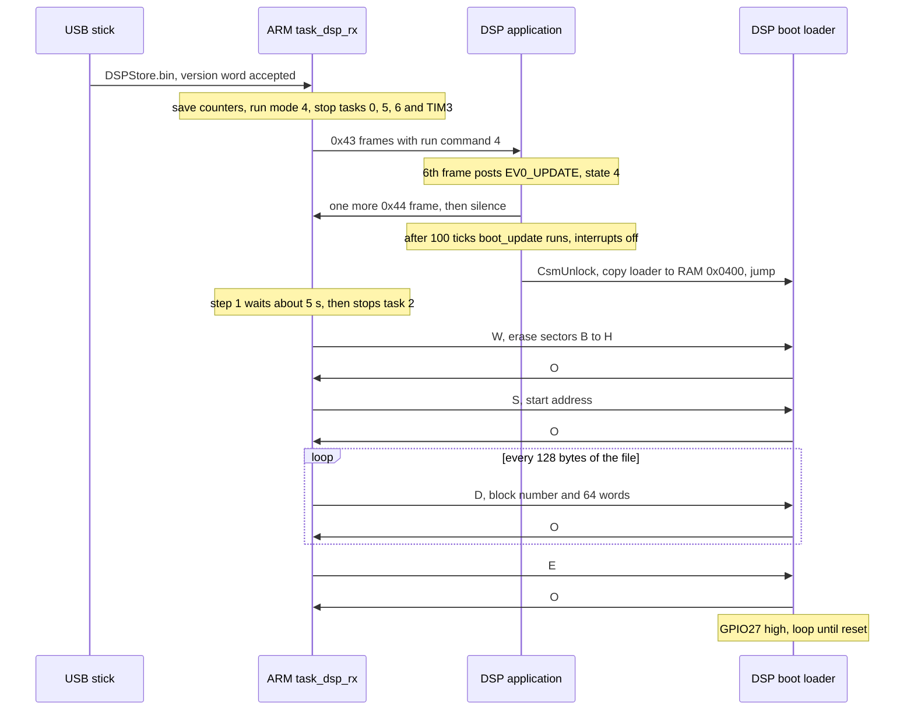
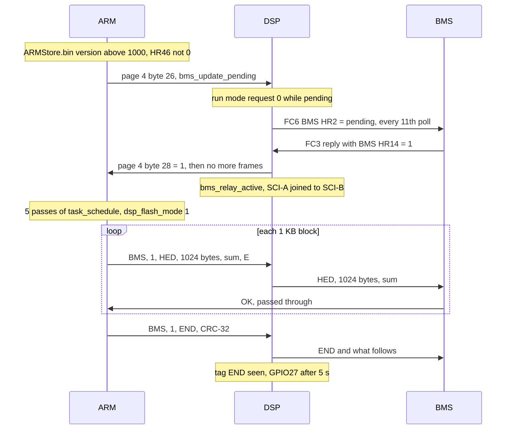

# Update packages and the boot loaders

Version scope: the sizes and code paths below describe A316/D316. The repository also
reconstructs A319/D319: its ARM file is 147,540 bytes including the four-byte header, and
its DSP file remains 131,072 bytes. Hashes are pinned in the manifest. See the
[319 guide](../../inverters/gen3-lv/docs/319-readability.md) for its proofs and changes.

GivEnergy ships the Gen3 LV firmware as packages named after both versions, such as
`A316-D316.zip`. The one this repository rebuilds holds two files (their names inside the zip
and their hashes are in [firmware/manifest.toml](../../firmware/manifest.toml)):

| File | Size | For |
|---|---|---|
| `ARMStore.bin` | 145,324 bytes | the ARM: a 4-byte header, then the Cortex-M3 image for 0x08014000 |
| `DSPStore.bin` | 131,072 bytes | the DSP: 64K 16-bit words for word addresses 0x3E8000 to 0x3F7FFF |

An owner copies the files to a USB stick and plugs it into the inverter's USB port. The ARM
reads the stick and starts at most one update. This page describes the file formats, the flow,
and what each step checks, as the code shows them. It is a description, not instructions:
nothing in this repository builds a package or writes one to an inverter, and
[SECURITY.md](../../SECURITY.md) says why.

## ARMStore.bin

| Bytes | Content |
|---|---|
| 0-1 | version, little-endian: `3c 01` = 0x013C = 316 |
| 2-3 | 0x5566, little-endian: `66 55` |
| 4 .. | the image as it sits in flash from 0x08014000: the vector table (initial SP 0x2000A598, reset 0x0802D6A9), code, constants, armlink's region table and the compressed RW data |

[`usb_check_update_files`](../../inverters/gen3-lv/a316/src/app/usb/usbh_usr.c) reads only the
4 header bytes. It accepts the file when bytes 2-3 are 0x5566, and then:

- **version above 1000**: a battery image. It is relayed to the BMS when no relay has failed
  since the last restart and the BMS chip version (HR46, from DSP page 2) is not 0.
- **version below 1000**: an ARM image. It is taken when the version differs from the word at
  0x08013FFC and has the same hundreds (`v / 100` equal). So A316 takes A3xx but not A2xx or
  A4xx.
- otherwise the file is refused, and the "relay failed" block is cleared.

The battery test comes first, so a file with a version above 1000 is never taken as an ARM image.
`tools/fetch_firmware.py` makes the HEX form `A316.hex` from this file by dropping the header
([manifest.toml](../../firmware/manifest.toml), `skip = 4`, `base = 0x08014000`).

## DSPStore.bin

The file is the whole DSP flash range from 0x3E8000 to 0x3F7FFF, one 16-bit word per two bytes,
high byte first, with 0xFFFF in the holes.

| Word address | Content |
|---|---|
| 0x3E8000 | the version, 0x013C (316) ([`app_header.c`](../../inverters/gen3-lv/d316/src/boot/app_header.c)) |
| 0x3E8004 | `app_entry`, where the boot loader jumps |
| 0x3E8008 .. 0x3F3F35 | the application: code, the ramfunc load image, .cinit, constants |
| 0x3F3FFC | `app_valid` = 0x00AA, the last word that matters in sector B |
| 0x3F4000 .. 0x3F7FFF | sector A: the boot loader, `codestart` at 0x3F7FF6, the CSM password at 0x3F7FF8 |

The full layout is in [D316 notes.md](../../inverters/gen3-lv/d316/docs/notes.md) and
[boot.md](../../inverters/gen3-lv/d316/docs/subsystems/boot.md). `usb_check_update_files` reads
the first word (big-endian) and takes the file when it differs from the version the DSP reports
(page 3, bytes 28-29) and has the same hundreds, or when the DSP reports 0.

## Files on the stick

| File | What the ARM does |
|---|---|
| `DSPStore.bin` | the DSP update, below |
| `ARMStore.bin` | the ARM self-update or the battery relay, by version |
| `SN.txt` | copies its first 10 characters over the inverter serial number (with a one-byte overrun, A316 findings item 4) |
| `MSN.txt` | if nothing was started, deletes both image files; read during long waits (factory use, by inference) |

USB host mode starts 10 s after boot (`task_usb`, [usb_task.c](../../inverters/gen3-lv/a316/src/app/usb/usb_task.c)).
One stick starts one update ([A316 usb.md](../../inverters/gen3-lv/a316/docs/subsystems/usb.md)).

## The DSP update

The ARM sends the image over the normal link, to the DSP's boot loader, which copies a
flash-writing routine to RAM and takes the frames.

Sources: [`task_dsp_rx`](../../inverters/gen3-lv/a316/src/app/comm/dsp_link.c),
[`dsp_fw_update_process`](../../inverters/gen3-lv/a316/src/app/usb/usbh_usr.c),
[`arm_run_command`](../../inverters/gen3-lv/d316/src/app/comm/arm_link.c),
[`state4_update`](../../inverters/gen3-lv/d316/src/app/state/op_states.c),
[`boot_copy_run`](../../inverters/gen3-lv/d316/src/boot/boot_csm.c),
[`boot_flash_loader`](../../inverters/gen3-lv/d316/src/boot/boot_flash_loader.c).

### The boot loader protocol

Every frame from the ARM is `0x0A, len, command, data[len], sum` where sum is the 16-bit sum of
all the bytes before it, high byte first. The reply is `0x0A, 0, code, sum`, the code being 'O'
(0x4F) for done, 'C' (0x43) for a bad sum, or the flash API's status.

| Command | Data | Action |
|---|---|---|
| 'W' | none | `Flash_Erase(0xFE)`: sectors B to H. Sector A, with the boot loader, stays |
| 'S' | 4 bytes, high first | sets the flash word address |
| 'D' | 2-byte block number n and 128 bytes (64 words, each high byte first) | programs them at address + 64 x n, if that is below 0x3F4000; at or above, replies 'O' and writes nothing |
| 'F' | none | nothing (a hello) |
| 'E' | none | replies, then raises GPIO27 and loops |

The ARM sends 'W', 'S', the 'D' frames for the whole file, then 'E'. It never sends 'F'. 2000
calls (20 s) without an answer restart it from 'W'. The start address comes from the ARM's
variable `dsp_update_base`, whose initial value I have not checked; since word 0 of the file is
the version at 0x3E8000, the address is 0x3E8000 by inference. The blocks for sector A, at the end
of the file, are answered and not written.

### What starts the application again

[`boot_main`](../../inverters/gen3-lv/d316/src/boot/boot_main.asm) reads one word at every reset:
0xAA at 0x3F3FFC starts the application at 0x3E8004; anything else waits in the boot loader for
an update on SCI-A. 'W' erases that word with sector B, so from the erase until the block that
holds it is written, a reset lands in the boot loader. 'E' does not reset the DSP; the
watchdog is off, so the reset comes from outside (GPIO27, inference).

## The ARM self-update

The ARM does not write its own image. [`arm_fw_update_arm_bootflag`](../../inverters/gen3-lv/a316/src/app/usb/usbh_usr.c)
waits 2000 ticks, programs 0 over the version word at 0x08013FFC, and when that reads back 0
sets `arm_update_state` 2 and `cfg_changed_flags` bit 0. The boot loader below 0x08014000, which
is not in this image, then takes the image from the stick on the next start (inference: nothing
in A316 reads the file past its header).

What restarts the ARM is not in the ARM code. The ARM sends `cfg_changed_flags` on page 2,
byte 22, and the DSP raises GPIO27 after 751 passes (15 s) of it
([`status_led_and_reset`](../../inverters/gen3-lv/d316/src/app/power/power_limits.c)). That
GPIO27 resets the board, the ARM included, is inference.

## The battery firmware relay

A battery image travels ARM to DSP to BMS. The DSP only passes bytes through, and the BMS starts
the transfer.

Sources: [`bms_fw_update_process`](../../inverters/gen3-lv/a316/src/app/usb/usbh_usr.c),
[`task_schedule`](../../inverters/gen3-lv/a316/src/app/control/schedule_p3.c),
[`task6_bms_link`](../../inverters/gen3-lv/d316/src/app/battery/bms_link.c),
[`arm_link_frame`](../../inverters/gen3-lv/d316/src/app/comm/arm_link.c),
[`sci_rx`](../../inverters/gen3-lv/d316/src/drivers/sci.c),
[`status_led_and_reset`](../../inverters/gen3-lv/d316/src/app/power/power_limits.c).
The DSP keeps bytes 4 to 6 of each relay frame as a tag; when the tag reads "END" for 251 passes
(5 s) it raises GPIO27. If no tag comes, it raises GPIO27 after 15001 passes (5 min) of relaying.
What the BMS does with HR2 and with the frames is not in either image.

## What is checked, and what is not

| Step | Checked | Not checked |
|---|---|---|
| ARM, `DSPStore.bin` | the first word: a different version with the same hundreds, or a DSP that reports 0 | length, any checksum of the image, the contents |
| DSP boot loader, each frame | the 16-bit byte sum | the frame length of 'D' (a short frame programs stale buffer bytes), block order |
| DSP boot loader, each block | the block's first word below 0x3F4000 | where the block ends (an unaligned 'S' address could reach 63 words into sector A; the ARM sends 0x3E8000-based blocks) |
| DSP at reset | `app_valid` = 0xAA at 0x3F3FFC | any CRC or signature of the application |
| ARM, `ARMStore.bin` | 0x5566 and the version rules | everything after byte 3 |
| ARM boot loader | not in this image | not known |
| Battery relay | version above 1000, HR46 not 0, an "OK" per block | the CRC-32 the ARM sends is a constant (A316 findings item 1); a block of only 0xFF bytes is not sent and times out (item 10) |

So a DSP image is accepted on its version word and per-frame sums alone. The per-tree findings
have the details: [A316 findings](../../inverters/gen3-lv/a316/docs/findings.md) items 1, 2, 10;
[D316 findings-comm](../../inverters/gen3-lv/d316/docs/findings-comm.md) items 2 to 4.

## See also

- [../development/modding.md](../development/modding.md): what a changed image would need on each
  chip, and why this repository stops short of flashing.
